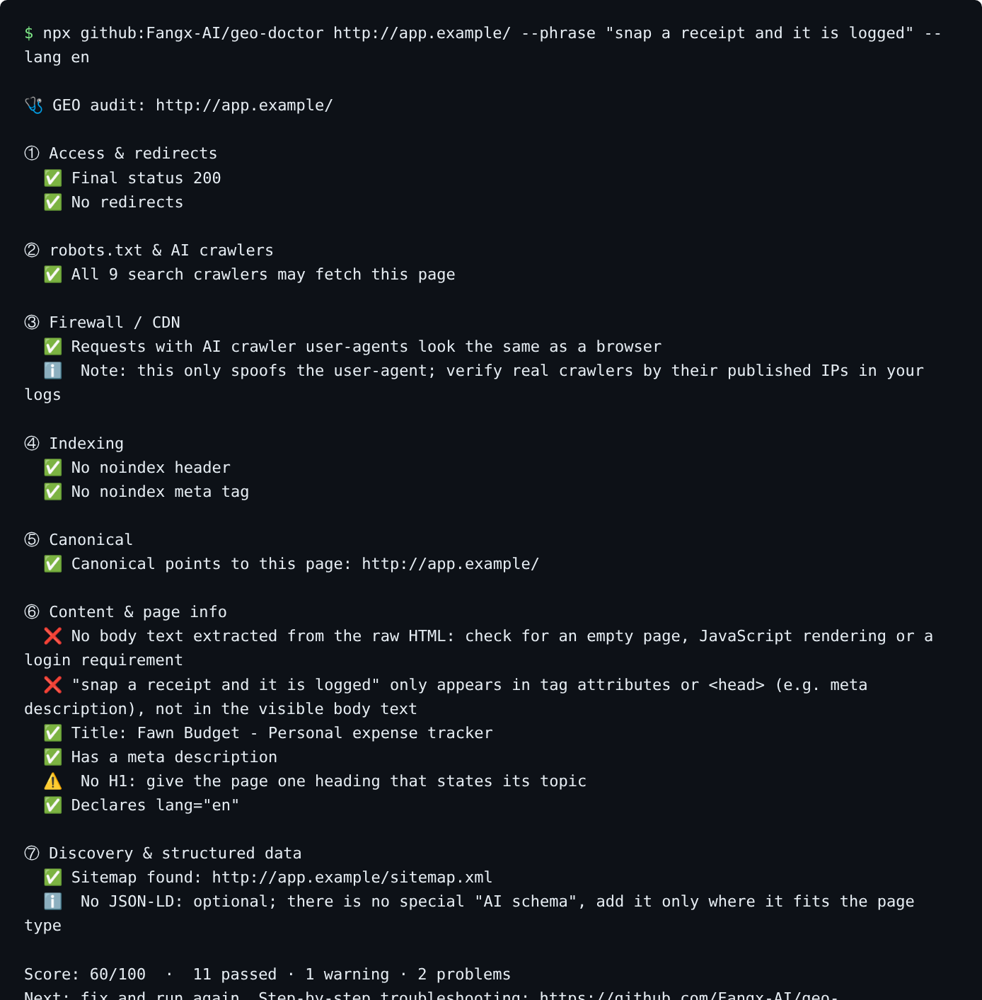

<div align="center">

# 🩺 GEO Doctor

### Get ChatGPT, Claude, Perplexity and Gemini to recommend your product

Works for English and Chinese sites: ChatGPT, Claude, Perplexity, Gemini, Google AI Overviews and Copilot,<br>plus Doubao, DeepSeek, Yuanbao, Qwen, ERNIE and Kimi in China.

Install it into your AI assistant with one sentence. It finds out why AI leaves you out or gets your facts wrong,<br>helps you fix your pages, write the content, decide where to publish, then re-tests to show whether it worked.

<table>
<tr>
<td align="center" width="33%"><b>🔍 Finds the problem</b><br><sub>Audits your site and lists, check by check, what AI crawlers can't read, with fixes</sub></td>
<td align="center" width="33%"><b>✍️ Fixes it honestly</b><br><sub>Writes only from facts you confirmed. No hype, no made-up claims, no fake reviews</sub></td>
<td align="center" width="33%"><b>📊 Measures it</b><br><sub>Asks the same questions before and after, and reports mention rate with sample sizes. No ranking promises</sub></td>
</tr>
</table>

**Free and open source** · **No server** · **One-sentence install** · **English and Chinese**

[](https://github.com/Fangx-AI/geo-doctor/stargazers)
[](https://github.com/Fangx-AI/geo-doctor/actions/workflows/test.yml)
[](skills/geo-doctor/SKILL.md)

[📦 Install](#install) · [🩺 What it does](#what) · [❓ FAQ](#faq) · [🧰 No-install audit](#quickstart) · [📚 Handbook](#handbook) · [中文](README.md)

</div>

<p align="center"></p>
<p align="center"><sub>Real, unedited output of the audit step, run against a local test page: crawlers are allowed, but the raw HTML is an empty <code>&lt;div id="root"&gt;</code>, so AI crawlers that don't run JavaScript can't read the text.</sub></p>

---

People now ask AI directly: "best CRM for a 10-person startup?", "an expense app that works offline?"

**If the answer leaves you out, or gets your pricing and features wrong, you are losing customers without noticing.** GEO Doctor puts a complete, evidence-based method into the AI assistant you already use. You just say "help me with GEO".

<a id="install"></a>

## 📦 Install: send one sentence to your AI

In Claude Code, Codex, Kimi Code, WorkBuddy or any assistant that can install skills, open a new chat and send:

```text
Install this skill: https://github.com/Fangx-AI/geo-doctor/tree/master/skills/geo-doctor
```

Then say **"help me with GEO"**. It asks a few questions first, then starts the audit, and answers in your language.

| Tool | Other ways to install |
| --- | --- |
| **Claude Code** | `/plugin marketplace add Fangx-AI/geo-doctor`, then `/plugin install geo-doctor@geo-doctor` |
| **Codex** | Ask `$skill-installer` to install `skills/geo-doctor` from this repo, or copy the folder to `~/.agents/skills/geo-doctor/` |
| **Apps that accept skill uploads** | Download `geo-doctor.zip` from [Releases](https://github.com/Fangx-AI/geo-doctor/releases) and upload it on the skills page |

<a id="what"></a>

## 🩺 What it does

Like a doctor's visit, in eight steps, each with a file you keep:

| Step | You say | GEO Doctor | You get |
| --- | --- | --- | --- |
| 0 Intake | "help me with GEO" | Asks about your product, your market and which AI matters most, then researches your industry | Case notes |
| 1 Audit | "can AI read my site?" | Checks robots.txt, AI crawlers, firewalls, noindex, and whether your copy is in the raw HTML | Issue list with fixes |
| 2 Fact card | "organize my product facts" | Collects facts from your site, pricing and docs, and flags channels that disagree | One source of truth |
| 3 Questions | "how do people ask AI?" | Writes 20–30 questions in your users' own words and picks 10 core ones | Question set |
| 4 Sampling | "what does AI say about me now?" | Tells you which 10 questions to ask in your target AI; you paste the answers back | Answer archive |
| 5 Diagnosis | "why doesn't it recommend me?" | Computes mention and accuracy rates, finds who AI cites and why competitors win | Prioritized prescription |
| 6 Writing | "write it for me" | Writes only for the gaps, only from the fact card, with checks for hype and violations | Pages, FAQs, comparisons, scripts |
| 7 Publishing | "where do I post this?" | Picks platforms by target AI: Google and Bing indexing and AI search crawlers overseas, Douyin, Toutiao or WeChat in China | Publishing plan |
| 8 Re-test | "two weeks later, did it work?" | Asks the same questions again and compares, with sample sizes | Re-test report |

Supports **software, apps, websites, mini programs and online products**. A local-business version is in progress.

<a id="faq"></a>

## ❓ FAQ

**Does it cost anything?** No. The skill and the audit script are open source (MIT). It only uses your own AI assistant's quota.

**Is it safe?** The audit script has zero dependencies. It only fetches the URL you give it plus its robots.txt and sitemap.xml, uploads nothing to third parties and reads no keys. It fetches pages with AI crawler user-agents to check whether your firewall blocks them, so only audit sites you own.

**Can it guarantee ChatGPT will recommend me?** No, and nobody can. GEO Doctor finds what AI can't read or gets wrong, helps you fix it, and re-asks the same questions to show what changed. If someone guarantees placement, ask them for the denominator and the raw records.

**Will it write fake content or reviews?** No. Every fact it writes must be one you confirmed. Mass-produced lookalike posts, fake reviews and inflated numbers are refused in the skill itself.

**Can I use it inside ChatGPT or Doubao?** Plain chat apps can't install skills yet. Run the diagnosis in an assistant that can, then ask your questions in ChatGPT, Claude or Doubao when sampling, because what users see in the app is what counts.

<a id="quickstart"></a>

## 🧰 No skill? Run the audit directly

No install, works on Windows / macOS / Linux with Node.js 18+:

```bash
npx github:Fangx-AI/geo-doctor https://your-site.com/pricing --phrase "a key sentence from the page"
```

Seven groups of checks and a 0–100 score: status and redirects, robots.txt rules for 9 AI and search crawlers (RFC 9309 longest-match, wildcards), whether a firewall/CDN blocks AI crawler user-agents, `noindex` in headers and meta, canonical, whether your copy is in the raw HTML (not only rendered by JavaScript), sitemap and JSON-LD. Add `--json` for machine output, `--report report.md` for a Markdown report, `--fail-under 80` to fail CI.

**GitHub Action**: catch a staging `noindex` or `Disallow: /` before it reaches production.

```yaml
- uses: Fangx-AI/geo-doctor@master
  with:
    urls: |
      https://example.com/
      https://example.com/pricing
    fail-under: 80
```

No Node? Use [`toolkit/geo-audit.sh`](toolkit/geo-audit.sh) (macOS / Linux) or [`toolkit/geo-audit.ps1`](toolkit/geo-audit.ps1) (Windows) with fewer checks.

<a id="handbook"></a>

## 📚 The GEO handbook (Chinese)

The skill is built on a field guide written in Chinese. Every claim links to an official doc or a published study.

| Part | What you get |
| --- | --- |
| [GEO in 5 minutes](docs/basics.md) | The 6 stages behind an AI answer (crawl → index → retrieve → generate → cite → act) and how to tell where you're stuck |
| [12 GEO myths](docs/myths.md) | e.g. *Google Search does not use llms.txt*; *blocking GPTBot does not remove you from ChatGPT search*. Each one cites the source |
| 8 playbooks | [Website](docs/playbooks/website.md) · [WeChat Mini Program](docs/playbooks/mini-program.md) · [SaaS/App](docs/playbooks/product.md) · [Local business](docs/playbooks/local-business.md) · [E-commerce](docs/playbooks/ecommerce.md) · [B2B services](docs/playbooks/b2b.md) · [Creators](docs/playbooks/creator.md) · [Multilingual](docs/playbooks/multilingual.md) |
| Platform rules | [Google, Bing/Copilot, ChatGPT, Perplexity, Claude](docs/platforms/international.md) · [Doubao, DeepSeek, Baidu, Yuanbao, Kimi, Qwen](docs/platforms/china.md) |
| [Measurement](docs/measurement.md) | Mention → citation → supported citation → visit → conversion, with a 16-row worked example and a local script |
| [Case teardowns](docs/cases.md) · [Studies](docs/studies.md) · [Papers](docs/research.md) | What the numbers actually mean: denominators, controls, percentage points vs percent |

## Other tools

- [`toolkit/robots-ai-bots.txt`](toolkit/robots-ai-bots.txt): robots template grouped by *search / training / user-triggered* crawlers.
- [`toolkit/prompts.md`](toolkit/prompts.md): 10 prompts (Chinese) for question mining, fact cards, rewriting, fact-checking AI citations, and diagnosing wrong answers.

All sources verified on 2026-10-14. Contributions (especially cases with disclosed denominators) are welcome. See [CONTRIBUTING.md](CONTRIBUTING.md).

If this helps you, a ⭐ star helps others find it.

<sub>geo-doctor (GEO 医生, formerly GEO-Playbook) · Generative Engine Optimization playbook. Text, templates and diagrams: [CC BY 4.0](LICENSE). Scripts: [MIT](scripts/LICENSE).</sub>
