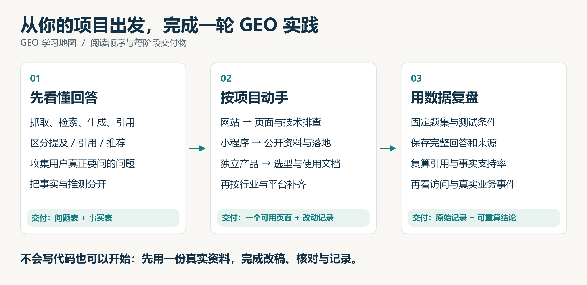

<div align="center">

# 🩺 GEO 医生 · GEO-Playbook

### 一句话，让 AI 帮你做完一整套 GEO：<br>查清豆包、DeepSeek、元宝为什么不推荐你，改对资料，写好内容，告诉你发到哪，再测有没有用

**开源的中文 GEO（生成式引擎优化）skill**，装进 Claude Code、Codex、Kimi、WorkBuddy、豆包就能用。<br>
不用服务器，不用网页，不保排名，只给证据。

[](https://github.com/Fangx-AI/GEO-Playbook/stargazers)
[](https://github.com/Fangx-AI/GEO-Playbook/actions/workflows/test.yml)
[](#evidence)
[](skills/geo-doctor/SKILL.md)
[](CONTRIBUTING.md)

[📦 安装](#install) · [🩺 它会做什么](#what) · [🧰 网站体检命令](#quickstart) · [🚧 AI 爬虫封锁榜](docs/ai-crawler-leaderboard.md) · [📚 实战手册](#routes)

</div>

---

用户越来越多地直接问 AI："20 人团队用什么知识库？""有没有不用联网的记账 App？"

**AI 的回答里没有你，或者把你的价格、功能说错了，你就在悄悄失去用户。** GEO 服务商报价几千到几万，效果却说不清。GEO 医生把整套方法装进你已经在用的 AI 助手里，你只要说一句"帮我做 GEO"。

<a id="what"></a>

## 🩺 它会做什么

像看病一样，八步走完，每一步都有交付物：

| 步 | 你说 | GEO 医生做什么 | 你拿到 |
| --- | --- | --- | --- |
| 0 问诊 | "帮我做 GEO" | 问清产品、想被哪个 AI 推荐，联网调研你的行业 | 病历 |
| 1 体检 | "AI 能读到我的网站吗" | 查 robots、AI 爬虫、noindex、正文能不能被读到 | 问题清单和修法 |
| 2 事实卡 | "帮我整理产品资料" | 从官网、价格页、文档里整理事实，找出各渠道说法不一致的地方 | 唯一事实源 |
| 3 问题集 | "用户会怎么问 AI" | 用真实用户的原话，写 20 到 30 道题，挑 10 道核心题 | 问题清单 |
| 4 采样 | "AI 现在怎么说我" | 告诉你去目标 AI 里问哪 10 道题，你把回答贴回来 | 回答存档 |
| 5 诊断 | "为什么不推荐我" | 算提及率、正确率，找出 AI 引用了谁、同行赢在哪 | 按优先级排的处方 |
| 6 写内容 | "帮我写" | 只针对缺口写，只用事实卡里的事实，自带夸大和违规检查 | 文章、FAQ、对比页、口播稿 |
| 7 发布指导 | "发到哪、怎么发" | 按"你想被哪个 AI 推荐"选平台，给出入口、写法和节奏 | 发布计划表 |
| 8 复查 | "两周了，有用吗" | 同一批题再测，前后对比，写明样本数 | 复查报告 |

目前支持**软件、App、网站、小程序和线上产品**。本地门店版本在路上。

> 为什么"采样"要你自己去问？因为你在 App 里看到的回答，才是你的用户看到的。AI 每次回答都不一样，所以每题问 2 次，看出现率而不是单次排名。只想提高豆包，就只问豆包，一轮 15 到 20 分钟。

<a id="install"></a>

## 📦 安装：复制一句话发给你的 AI

在豆包、WorkBuddy、扣子、Kimi、Codex、Claude Code 等支持技能的 AI 里，新开一个对话，发送：

```text
帮我安装这个 skill：https://github.com/Fangx-AI/GEO-Playbook/tree/master/skills/geo-doctor
```

装好后说：**"用 GEO 医生帮我看看 https://你的网站"**。

> 各平台的对话安装还在逐一实测，结果会更新在[安装指南](docs/install.md)。AI 说"装不了"或打不开链接时，可以用下面的方式，或[提 issue](https://github.com/Fangx-AI/GEO-Playbook/issues/new/choose) 告诉我们是哪个平台。

<details>
<summary markdown="span"><b>其他安装方式</b>（命令行、手动复制、上传压缩包）</summary>

| 你用的工具 | 怎么装 |
| --- | --- |
| **Claude Code** | 输入 `/plugin marketplace add Fangx-AI/GEO-Playbook`，再输入 `/plugin install geo-doctor@geo-playbook` |
| **Codex** | 请 `$skill-installer` 安装本仓库的 `skills/geo-doctor`，或把完整文件夹放到 `~/.agents/skills/geo-doctor/` |
| **Kimi Code** | 把完整文件夹放到 `~/.kimi-code/skills/geo-doctor/`，新开会话后使用 |
| **支持上传技能包的客户端** | 在 [Releases](https://github.com/Fangx-AI/GEO-Playbook/releases) 下载 `geo-doctor.zip`，在技能页面上传 |

</details>

---

> 🚧 **[中文网站 AI 爬虫封锁榜](docs/ai-crawler-leaderboard.md)**：我们读取了 97 个知名中文网站的 robots.txt。**知乎、小红书、微博、贝壳、马蜂窝都把 ChatGPT 搜索、Perplexity、Claude 搜索挡在门外**，微博还点名屏蔽了 DeepSeek、Kimi、豆包。[看完整榜单和方法 →](docs/ai-crawler-leaderboard.md)

<a id="quickstart"></a>

## 🧰 不装 skill 也能用：15 分钟上手

**① 看看 AI 现在怎么说你（5 分钟）**

打开你的用户常用的 AI（豆包、DeepSeek、元宝、ChatGPT 都可以），问 3 个**不带你品牌名**的真实问题，比如“杭州西湖区周末能带电脑的安静咖啡店”。保存回答，打开它引用的来源，看看有没有你、说得对不对。

**② 检查 AI 能不能读到你的网站（2 分钟）**

装了 [Node.js](https://nodejs.org/zh-cn)（18 以上）就能直接跑，Windows / macOS / Linux 通用，不用下载任何东西：

```bash
npx github:Fangx-AI/GEO-Playbook https://你的网站/重要页面 --phrase "页面里的一句关键正文"
```

它会检查 7 类问题并打分：状态码与跳转、robots.txt 对 9 个 AI / 搜索爬虫的规则、防火墙是否在拦 AI 爬虫、noindex、canonical、正文是否真的在原始 HTML 里、sitemap 与结构化数据。只读取公开页面。

分数是这些技术检查的汇总，不是 AI 推荐概率。原始 HTML 里正文不到 50 字，或 `#app`、`#root` 这类挂载点是空的、只有"加载中"（典型的 JS 空壳页，导航和页脚文字不算正文），算致命问题；50 到 200 字只提醒，不扣分；用 `--phrase` 找到了关键句的短页面也不算空壳。提取到文字不代表关键内容齐全，建议用 `--phrase` 核对价格、功能等重要事实。

<details>
<summary markdown="span"><b>👀 看看输出长什么样</b>（模拟页面，查出一个致命问题和几个小问题）</summary>

```text
🩺 GEO 体检：https://example.com/p/pricing.html

① 访问与跳转
  ✅ 最终状态码 200
  ✅ 无跳转

② robots.txt 与 AI 爬虫
  ✅ 9 个搜索类爬虫都可以抓取这个页面
  ℹ️  训练用途的 GPTBot 被禁止：不影响搜索可见性，如果是有意为之可忽略

③ 防火墙 / CDN
  ✅ 用 AI 爬虫的 UA 访问，与浏览器结果一致
  ℹ️  注：这里只模拟 UA，真实爬虫还要按官方 IP 核对服务器日志

④ 索引控制
  ✅ 响应头无 noindex
  ❌ robots meta 含 noindex：检查 CMS 的“阻止搜索引擎”开关

⑤ 规范地址
  ⚠️  canonical 指向别处：https://example.com/（产品页误指首页很常见）

⑥ 正文与页面信息
  ✅ 原始 HTML 里有约 399 字正文
  ✅ 原始 HTML 里找到指定正文「团队版每月 299 元」
  ✅ 标题：价格 - 示例文档工具
  ⚠️  没有 meta description：搜索结果和部分 AI 摘要会自己截一段
  ✅ H1：价格
  ⚠️  <html> 没有 lang 属性：多语言站点尤其要加

⑦ 发现与结构化数据
  ⚠️  没找到 sitemap（robots.txt 未声明，/sitemap.xml 也不存在）
  ℹ️  没有 JSON-LD：不是必需项，官方没有“AI 专用 schema”，只在符合页面类型时添加

得分：60/100  ·  9 项通过 · 4 项注意 · 1 项问题
```

这个页面在浏览器里看一切正常，但 noindex 会让它不进搜索索引，canonical 又把它指向了首页。这类问题肉眼看不出来，所以先跑一遍。

</details>

<details>
<summary markdown="span"><b>没装 Node.js？</b>用 bash / PowerShell 脚本（检查项少一些）</summary>

macOS / Linux：

```bash
curl -O https://raw.githubusercontent.com/Fangx-AI/GEO-Playbook/master/toolkit/geo-audit.sh
bash geo-audit.sh https://你的网站/重要页面 "页面里的一句关键正文"
```

Windows（PowerShell）：

```powershell
curl.exe -O https://raw.githubusercontent.com/Fangx-AI/GEO-Playbook/master/toolkit/geo-audit.ps1
powershell -ExecutionPolicy Bypass -File geo-audit.ps1 https://你的网站/重要页面 "页面里的一句关键正文"
```

</details>

**③ 把一段广告文案改成 AI 会引用的样子（5 分钟）**

复制 [提示词 P3](toolkit/prompts.md#p3)，填入你的产品事实和原文案。对比一下：

> ❌ **改前**：新一代企业级智能知识管理平台，全面兼容各种文件，快速无损迁移，超高性价比。
>
> ✅ **改后**：云端团队文档工具，**不支持内网部署**。团队版 299 元/月含 20 席，25 人为 299 + 5 × 20 = 399 元。支持 Markdown、HTML、文本型 PDF；**扫描版 PDF 不能搜索正文**。导出包含正文和附件，**不含评论和历史版本**。

改后的每一句都是能被引用、能被核对的事实，**连“不支持什么”都写清楚**。这正是 AI 回答“适不适合我”时最需要的信息。（示例产品为虚构，完整课程见 [改稿实战课](docs/content-rewrite.md)。）

<a id="routes"></a>

## 🗺 按你的项目选一条路线

不用从头读完。找到你的项目，点进去照着做。每条路线都写明了用时、交付物和验收标准。

| 我是… | 路线 | 做完你手里有 | 用时 |
| --- | --- | --- | --- |
| 🌐 官网、博客、公司网站 | [网站实战](docs/playbooks/website.md) | 访问诊断 · 一个改好的页面 · 基线表 | 7 天 |
| 💬 微信小程序 | [小程序实战](docs/playbooks/mini-program.md) | 公开服务说明 · 路径映射 · 四环境入口实测 | 7 天 |
| 🧩 SaaS / App / 桌面软件 / 插件 | [独立产品实战](docs/playbooks/product.md) | 产品事实表 · 关键页面 · 三类题验收 | 7 天 |
| 📍 餐饮、美业、健身、民宿、家政 | [本地商家实战](docs/playbooks/local-business.md) | 门店事实卡 · 地图纠错 · 到店追踪 | 1–2 周 |
| 🛒 电商、品牌商品 | [电商实战](docs/playbooks/ecommerce.md) | SKU 事实台账 · 四处一致性核对 | 半天起 |
| 🤝 咨询、代理、实施等 B2B 服务 | [B2B 服务实战](docs/playbooks/b2b.md) | 服务交付卡 · 过程案例 | 1 天起 |
| 🎙 视频、播客、媒体创作者 | [创作者实战](docs/playbooks/creator.md) | 校订字幕 · 章节 · 证据表 | 半天 |
| 🌏 出海、多语言站点 | [多语言实战](docs/playbooks/multilingual.md) | 分市场事实卡 · hreflang 检查 | 1 天起 |

路线可以组合，比如咖啡店先走本地商家，再补小程序预约。

<details>
<summary markdown="span"><b>🔍 从问题找答案：24 个最常见的 GEO 问题</b></summary>

| 我遇到的问题 | 去哪看 |
| --- | --- |
| 已有几十页官网，先改哪一页？ | [网站：按当前状态选入口](docs/playbooks/website.md) |
| 网页能搜到，AI 却从不引用，先查什么？ | [网站：诊断与故障排查](docs/playbooks/website.md) |
| 正文依赖 JavaScript 或登录，怎么办？ | [网站：原始 HTML 与渲染](docs/playbooks/website.md) |
| 产品页、FAQ、帮助文档分别该回答什么？ | [改稿课：16 道采购问题如何分组](docs/content-rewrite.md) |
| robots、sitemap、结构化数据、llms.txt，怎么选？ | [误区辟谣](docs/myths.md) · [robots 模板](toolkit/robots-ai-bots.txt) |
| 只有小程序，没有官网，从哪里开始？ | [小程序：按现有入口选方案](docs/playbooks/mini-program.md) |
| 二维码和小程序路径能让 AI 读到内容吗？ | [小程序：四层对象与证据](docs/playbooks/mini-program.md) |
| 价格、预约规则和介绍放哪里？ | [小程序：公开页面与路径映射](docs/playbooks/mini-program.md) |
| 小程序、公众号和商家资料互相冲突怎么办？ | [门店事实卡](docs/playbooks/local-business.md) · [提示词 P10](toolkit/prompts.md#p10) |
| AI 推荐后，怎样让用户完成小程序预约？ | [小程序：四环境入口测试](docs/playbooks/mini-program.md) |
| 新产品没案例没媒体报道，先写什么？ | [独立产品：事实表与首批页面](docs/playbooks/product.md) |
| 用户不知道我的名字，怎样研究提问？ | [提示词 P1](toolkit/prompts.md#p1) · [改稿课](docs/content-rewrite.md) |
| 定价经常变，AI 一直说旧价怎么办？ | [提示词 P10](toolkit/prompts.md#p10) · [网站故障表](docs/playbooks/website.md) |
| 要不要写替代品或竞品比较页？ | [独立产品：七类信息](docs/playbooks/product.md) · [提示词 P8](toolkit/prompts.md#p8) |
| 官网、文档、更新日志、商店如何分工？ | [独立产品：页面任务清单](docs/playbooks/product.md) |
| 门店的地址、营业时间、服务区域怎样维护？ | [本地商家实战](docs/playbooks/local-business.md) |
| 几百个 SKU，价格库存从哪里整理？ | [电商：先完成一个变体的事实台账](docs/playbooks/ecommerce.md) |
| B2B 软件怎样写清部署、权限与迁移？ | [改稿实战课](docs/content-rewrite.md) |
| 服务公司没有增长数据，怎样写真实案例？ | [B2B：过程与交付证据](docs/playbooks/b2b.md) |
| 面向不同国家，哪些能翻译、哪些要重写？ | [多语言实战](docs/playbooks/multilingual.md) |
| 第一次测量选哪些题、怎么保留原始记录？ | [测量课](docs/measurement.md) · [提示词 P9](toolkit/prompts.md#p9) |
| 改完仍零引用，下一步检查什么？ | [网站排错](docs/playbooks/website.md) · [测量条件](docs/measurement.md) |
| 偶尔一次被推荐，能说有效吗？ | [Webflow 案例与对照读法](docs/cases.md#webflow) |
| 提及、引用、访问和有效咨询怎么分开？ | [测量：五层漏斗](docs/measurement.md) |

</details>

<a id="toolkit"></a>

## 🧰 工具箱：复制就能用

| 工具 | 解决什么问题 |
| --- | --- |
| [🩺 geo-audit 命令行工具](cli/geo-audit.mjs) | AI 爬虫能不能读到你的页面？`npx` 一行运行，7 类检查 + 0–100 分 + Markdown 报告。也有 [bash](toolkit/geo-audit.sh) / [PowerShell](toolkit/geo-audit.ps1) 版 |
| [⚙️ GitHub Action](#ci) | 每次发布自动体检，分数掉了就让 CI 变红 |
| [🤖 AI 爬虫 robots 模板](toolkit/robots-ai-bots.txt) | 按“搜索 / 训练 / 用户触发”分组，放行哪个、屏蔽哪个一目了然 |
| [💬 10 个 GEO 提示词](toolkit/prompts.md) | 挖用户问题 → 整理事实卡 → 改稿 → 审稿 → 写 FAQ → 核查引用 → 诊断错误 |
| [✅ 3 张检查清单](toolkit/checklists.md) | 15 分钟体检 · 发布前审核 · 每周观察 |
| [📋 事实卡模板](toolkit/templates/fact-card.yaml) · [题集模板](toolkit/templates/question-set.csv) | 所有渠道的唯一数据源；可重复测量的固定问题 |
| [📊 观察记录表 + 汇总脚本](docs/measurement.md) | 记录 AI 回答与引用，自动算出提及率、引用率、准确率 |

<a id="ci"></a>

### ⚙️ 给开发者：在 CI 里自动体检

上线前最常见的事故是测试站的 `noindex` 或 `Disallow: /` 被带到生产环境。把下面这段放进 `.github/workflows/geo.yml`，每次部署后自动检查，分数低于阈值就报错，报告会显示在 Actions 的运行摘要里：

```yaml
name: geo-audit
on:
  deployment_status:
  workflow_dispatch:
jobs:
  geo:
    if: github.event_name == 'workflow_dispatch' || github.event.deployment_status.state == 'success'
    runs-on: ubuntu-latest
    steps:
      - uses: Fangx-AI/GEO-Playbook@master
        with:
          urls: |
            https://example.com/
            https://example.com/pricing
          fail-under: 80
          lang: zh
```

也可以直接调用：`npx github:Fangx-AI/GEO-Playbook 网址 --json` 输出 JSON，`--fail-under 80` 低于 80 分时退出码为 1。

`--fail-under` 只接受 0–100 的数值；参数缺值、阈值无效或 `--lang` 不是 `zh` / `en` 时，退出码为 2，并在开始请求网页前报错，避免 CI 因配置拼写错误而静默放行。

## 🧠 GEO 核心原则速记

1. **先定位卡在哪一关**：抓取 → 索引 → 检索 → 生成 → 引用 → 行动。不知道卡在哪，写再多内容也没用。（[5 分钟入门](docs/basics.md)）
2. **技术三件套先排查**：robots 误封、遗留 noindex、canonical 指错，外加 JS 渲染的空壳页。
3. **搜索、训练、用户访问三类爬虫分开管**：屏蔽训练不会让你从 AI 搜索里消失。
4. **一张事实卡管所有渠道**：官网、商店、地图、公众号说法不一致，AI 就会说错。
5. **写事实，不写形容词**：人数、价格算式、系统要求、营业时间，比“领先、强大”有用一百倍。
6. **把“不适合谁”写出来**：帮 AI 正确排除你，和被推荐一样重要。
7. **从用户原话出发，不从关键词出发**：特别是不带品牌名的真实问题。
8. **提及 ≠ 引用 ≠ 准确 ≠ 访问 ≠ 成交**：五层分开记，哪层变好报哪层。
9. **百分点和百分比别混写**：8.48% → 56.35% 是 +47.87 个百分点，不是 +47.87%。
10. **没有公开的“排名公式”**：承诺保证上推荐的，先要分母和原始记录。

<a id="cases"></a>

## 📈 案例与研究：关键数字一览

| 来源 | 关键数字 | 一眼要看穿的地方 | 详细 |
| --- | --- | --- | --- |
| Pew 研究中心（2025） | 有 AI 摘要时传统结果点击 8%（无摘要 15%）；摘要内链接约 1% | 被引用 ≠ 有流量 | [研究速读](docs/studies.md) |
| Tow Center（2025） | 8 个 AI 搜索产品找新闻原文，超过 60% 的回答有错 | 有出处 ≠ 出处正确 | [研究速读](docs/studies.md) |
| Ahrefs（2025） | 网页 / YouTube 品牌提及与 AI 可见度强相关，页面数量弱相关 | 相关 ≠ 因果 | [研究速读](docs/studies.md) |
| Webflow × Graphite | 加目录后报告 +60% | 原始均值只是 119 → 127 | [案例精读](docs/cases.md#webflow) |
| Omnius | 自报 AI 点击 +138%、SQL +414% | 标题 106% 和正文 138% 是两个数 | [案例精读](docs/cases.md#omnius) |
| AirOps | 自报点击 +15%、AI 引用 +20% | 组合改动，无法归因到单项 | [案例精读](docs/cases.md#airops) |

## 📚 完整课程目录



**🟢 入门**
- [GEO 5 分钟入门：AI 是怎么决定提谁、引谁的](docs/basics.md)
- [12 个流行的 GEO 误区](docs/myths.md)

**🔵 核心技能**
- [改稿实战课：把广告文案改成 AI 会引用的页面](docs/content-rewrite.md)
- 8 条项目路线：[网站](docs/playbooks/website.md) · [小程序](docs/playbooks/mini-program.md) · [独立产品](docs/playbooks/product.md) · [本地商家](docs/playbooks/local-business.md) · [电商](docs/playbooks/ecommerce.md) · [B2B](docs/playbooks/b2b.md) · [创作者](docs/playbooks/creator.md) · [多语言](docs/playbooks/multilingual.md)

**🟣 平台规则**
- [国际平台：Google、Bing/Copilot、ChatGPT、Perplexity、Claude](docs/platforms/international.md)
- [中文平台：豆包、DeepSeek、百度、元宝、Kimi、千问](docs/platforms/china.md)

**🟠 测量与研究**
- [测量：怎样知道做完有没有用](docs/measurement.md)
- [真实案例精读](docs/cases.md) · [行业研究速读](docs/studies.md) · [论文与开源代码](docs/research.md)
- [工具选择](docs/tools.md) · [🎓 毕业项目](docs/capstone.md)

<a id="evidence"></a>

## 🏷 证据标签

每条资料都标明证据等级，避免把广告当事实：

| 标签 | 含义 |
| --- | --- |
| 🟢 官方 | 平台官方文档明确写出，附原文链接 |
| 📊 研究 | 独立机构或学术研究，附样本与局限 |
| 🟡 自报 | 实施方或服务商自己报告的案例结果，未经独立核实 |
| 🧪 教学 | 本项目为练习设计的虚构产品或模拟数据，不是真实成绩 |

全部资料核验于 **2026-10-14**。平台规则变化快，以链接原文的当前版本为准；发现过时信息欢迎提 Issue。

## 🤝 参与贡献

欢迎补充：**能公开分母和页面改动的中文平台案例**、新的官方文档、验证过的提示词、失败实验（没效果的实验同样有价值）。规则见 [CONTRIBUTING.md](CONTRIBUTING.md)，不熟悉 Git 可以直接 [提 Issue](https://github.com/Fangx-AI/GEO-Playbook/issues/new/choose)。

**如果这份手册帮到了你，点个 ⭐ Star 是对我们最大的支持，也能让更多人看到它。**

[](https://star-history.com/#Fangx-AI/GEO-Playbook&Date)

---

<sub>GEO-Playbook（GEOPlaybook）· GEO 实战手册 · AI 搜索优化 / GEO 优化中文指南。结构参考 [Maxime Labonne 的 LLM Course](https://github.com/mlabonne/llm-course)。原创文字、模板与图解采用 [CC BY 4.0](LICENSE)；脚本采用 [MIT](scripts/LICENSE)。外部文章、论文、代码、商标和图片保留各自权利。图片说明见 [assets/README.md](assets/README.md)。</sub>
