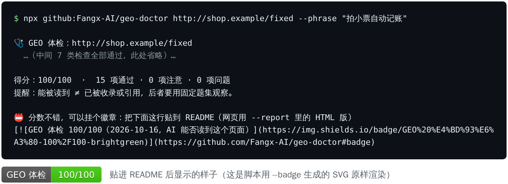

> [GEO 医生](../README.md) › 体检徽章

# 📛 体检徽章：把分数挂出来

体检到 **80 分以上**，命令行最后会多给你一行徽章代码。把它贴到你的 README 或官网页脚，就会显示成这样：

<p align="center"></p>
<p align="center"><sub>把一个 60 分的 JavaScript 空壳测试页修好（正文写进 HTML、加上 H1）后重新体检的真实输出，中间省略了 7 类检查。</sub></p>

徽章告诉访客两件事：这个网站认真对待了 AI 搜索，而且 AI 爬虫能顺利读到它。

**三种用法**

| 场景 | 怎么做 |
| --- | --- |
| 贴到 GitHub README | 复制体检结果最后那行 Markdown，粘贴进 README |
| 放到官网页脚 | 加 `--report audit.md` 再跑一次，报告末尾有 HTML 版，复制进页面 |
| 国内网络更稳的版本 | 加 `--badge geo-badge.svg`，生成一个不依赖外部服务的 SVG 文件，放进你的仓库或网站引用即可 |

```bash
npx github:Fangx-AI/geo-doctor https://你的网站 --badge geo-badge.svg
```

## 让徽章每周自动更新（GitHub Actions）

在你的仓库里新建 `.github/workflows/geo-badge.yml`：

```yaml
name: GEO badge
on:
  schedule: [{ cron: "0 2 * * 1" }]   # 每周一自动体检
  workflow_dispatch:
permissions:
  contents: write
jobs:
  badge:
    runs-on: ubuntu-latest
    steps:
      - uses: actions/checkout@v4
      - uses: Fangx-AI/geo-doctor@master
        with:
          urls: https://你的网站/
          lang: zh
          badge: .github/geo-badge.svg
      - run: |
          git config user.name "github-actions[bot]"
          git config user.email "41898282+github-actions[bot]@users.noreply.github.com"
          git add .github/geo-badge.svg
          git diff --cached --quiet || (git commit -m "更新 GEO 体检徽章" && git push)
```

README 里用 `[](https://github.com/Fangx-AI/geo-doctor#badge)` 引用，分数就会跟着网站的实际情况变。


**颜色怎么看**：90 分以上深绿，80 到 89 浅绿，61 到 79 黄色，60 分及以下红色（有致命问题，比如 AI 读不到正文）。

> 徽章只代表那次技术体检的结果：AI 爬虫能不能读到这个页面，以及体检日期（写在徽章的说明文字里）。它**不代表** AI 一定会推荐这个网站。页面改版后请重新体检。
>
> **你是点了别人网站上的徽章过来的？** 想测测自己的网站，复制上面那行命令就行；想让豆包、DeepSeek、ChatGPT 推荐你，[一句话装上 GEO 医生](../README.md#install)。

---

[🏠 回首页](../README.md) · [GEO 实战手册](handbook.md)
