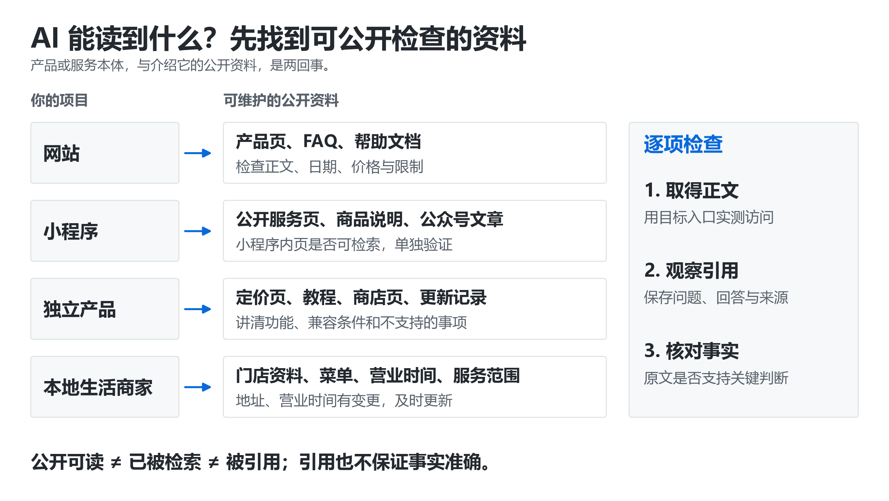

# ⚡ GEO 5 分钟入门：AI 是怎么决定提谁、引谁的

> [GEO 学习地图](../README.md) › 入门

**GEO（Generative Engine Optimization，生成式引擎优化）= 让 AI 搜索找得到你、说得对你、愿意引用你，并且让看到回答的人能顺利找到你。**

| ⏱ 用时 | 👤 适合谁 | 📦 读完你能 |
| --- | --- | --- |
| 5–15 分钟 | 第一次接触 GEO 的老板、运营、市场、开发 | 一眼判断“AI 没提我”卡在哪一环，知道下一步该看哪一章 |

---

## 一张图看懂：用户问一句话，AI 背后经过 6 关

```text
 ① 抓取        ② 索引         ③ 检索         ④ 生成         ⑤ 引用         ⑥ 行动
 能不能读到 → 有没有收进库 → 这次被选中没 → 回答里说了啥 → 标了谁的来源 → 用户点没点、买没买
 robots/WAF    站长工具状态    问题匹配度      事实是否准确    来源是否支持    访问/咨询/到店
```

任何一关卡住，后面都不会发生。**做 GEO 的第一步不是“写更多内容”，而是先定位你卡在哪一关。**

| 你观察到的现象 | 最可能卡在 | 先看哪里 |
| --- | --- | --- |
| AI 完全不知道你 | ①②：读不到或没收录 | [网站诊断](playbooks/website.md) · [小程序公开说明](playbooks/mini-program.md) |
| 知道你，但说错价格/功能/营业时间 | ④：公开资料互相矛盾或过时 | [改稿实战课](content-rewrite.md) · [产品事实表](playbooks/product.md) |
| 只在问你名字时才提到你 | ③：没有回答“非品牌”的真实问题 | [从买家原话出发](content-rewrite.md) |
| 提到了你，但没标你的官网 | ⑤：引用了第三方或转载 | [引用归因审计](studies.md) |
| 被引用了，却没带来咨询 | ⑥：入口或转化断了 | [测量五层漏斗](measurement.md) |

## GEO 和 SEO 是什么关系

| | SEO | GEO |
| --- | --- | --- |
| 用户看到的 | 10 条蓝色链接 | 一段直接回答 + 几个来源 |
| 你要争取的 | 排名、点击 | 被提及、被准确描述、被引用、被点击 |
| 底层基本功 | 可抓取、可索引、内容有用 | **完全相同**，GEO 建立在 SEO 基本功之上 |
| 新增的难点 | — | 回答是生成的、会变、可能说错；“被提到”不等于“有流量” |

Google 官方的生成式搜索指南也明确：AI 功能使用的是已有的搜索索引，内容有独特经验、站点可访问、结构清晰仍是基础。[官方指南](https://developers.google.com/search/docs/fundamentals/ai-optimization-guide)

## 6 个必须分清的词

- **抓取**：系统能否取得页面。你浏览器能打开，只说明一种访问条件。
- **索引与检索**：内容是否进了可搜索的库，以及这次问题有没有选中它。两件事分开排查。
- **提及 / 引用 / 推荐**：正文说到你的品牌、来源列表里有你的网址、把你列为适合的选择，是三个不同事件。
- **用户任务**：读者此刻想完成什么：理解概念、比较选项、确认价格、解决故障。
- **可核查证据**：结论对应的事实、数据、时间、对象和限制，让人能检查，不只是“读起来可信”。
- **效果测量**：提及、引用、点击、有效咨询分开记录。一层改善不代表下一层改善。

## 不同项目，哪些资料可以公开给 AI 读



产品本体可以在登录后或 App 内，但**陌生人判断“适不适合我”所需的事实，必须有一个公开可读的载体**。公开之后，还要分别验证检索、引用和用户行动。

## 5 分钟小练习

拿一个真实需求，分别用普通搜索和一个 AI 联网问答各问一次，保存结果。打开 AI 引用的 3 个来源，逐个标注：

1. 这个来源**支持**它旁边那句话吗？
2. 它是**原始来源**还是转载？
3. 它**过期**了吗？

做完你会发现：AI 的“引用”并不总是对的。这就是整门课的起点。

## 想深入，读这三份

- [Google：How Search Works](https://developers.google.com/search/docs/fundamentals/how-search-works) · 🟢 官方 · 入门。分清抓取、索引、展示，学会定位问题在哪一步。
- [Google：SEO Starter Guide](https://developers.google.com/search/docs/fundamentals/seo-starter-guide) · 🟢 官方 · 入门。页面组织、帮助发现、内容质量的基本功。
- [Introduction to Information Retrieval](https://nlp.stanford.edu/IR-book/) · 📄 斯坦福公开教材 · 进阶选读。只读第 8 章（检索评估）和第 19–21 章（网络搜索）即可。

---

**下一步** → 按你的项目选一条路线：[网站](playbooks/website.md) · [小程序](playbooks/mini-program.md) · [独立产品](playbooks/product.md) · [本地商家](playbooks/local-business.md) · [电商](playbooks/ecommerce.md) · [B2B](playbooks/b2b.md) · [创作者](playbooks/creator.md)

或者先看 [12 个流行的 GEO 误区](myths.md)，避免一开始就花错钱。

---

<div align="center">

[🏠 目录](../README.md) · [12 个 GEO 误区](myths.md) →

<sub>有帮助的话，回 [首页](../README.md) 点个 ⭐ Star；发现错误或过时信息，欢迎 [提 Issue](https://github.com/Fangx-AI/geo-learning-map/issues/new/choose)。</sub>

</div>
