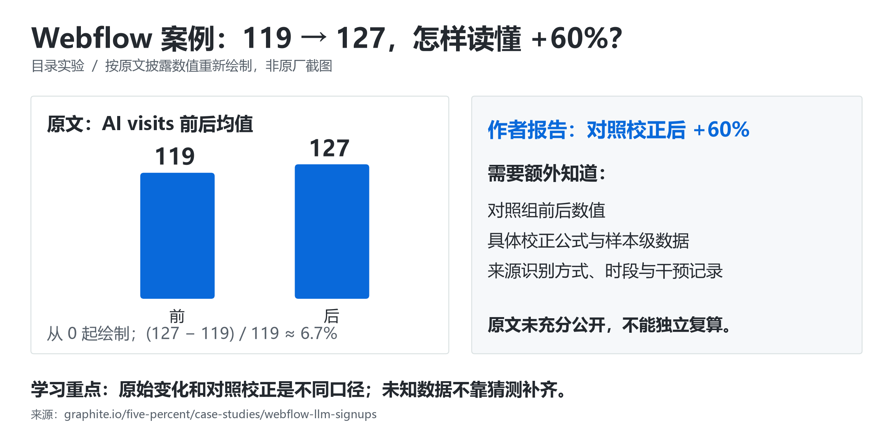

# 📈 真实案例精读：别人怎么做的，数字到底怎么算

> [GEO 学习地图](../README.md) › 测量与研究 › 案例精读

**4 个公开 GEO 案例：先看他们改了什么、报了什么数字，再学会一眼看穿口径，最后自己动手复现。**

| 案例 | 改了什么 | 对方报告的结果 | 一眼要看穿的地方 | 证据等级 |
| --- | --- | --- | --- | --- |
| [AirOps](#airops) | 旧文章：主题审计 → 刷新简报 → 内容优化 | 点击 +15%、展示 +22%、AI 引用 +20% | 组合改动，无法归因到单个 FAQ 或标题 | 🟡 实施方自报 |
| [Webflow × Graphite](#webflow) | 加文章目录；小标题改成问句 | 对照校正后 +60% / +58% | 原始均值只是 119→127（+6.7%） | 🟡 执行方自报，有对照 |
| [Omnius](#omnius) | 补适用/不适用场景，定义前移 | AI 点击 +138%、SQL +414% | 标题写 106%，正文写 138%，不能混用 | 🟡 自报，带推广目的 |
| [移山科技](#yishan) | 按年龄重写选购内容，纠正产品归属 | 可见率 8.48% → 56.35% | 这是 +47.87 个**百分点**，相对增长约 564.5% | 🟡 服务商自述，未核实 |

**读每个案例都问 4 个问题**：分母是多少？有没有对照组？同期还改了什么？没变好的样本去哪了？完整检查表见 [研究速读](studies.md#扩展读法给任何增长案例补齐这些字段)。

> 每个案例后面都附有本项目设计的 🧪 **复现练习**，不需要买原作者的工具。

---

<a id="airops"></a>

## 📝 AirOps：旧文章刷新三步工作流（自报 点击 +15%、AI 引用 +20%）

英文一手记录｜实施者自报，供应商自身案例｜发布：2025-07-01｜核验：2026-10-14

### 先还原真实流程：输入什么，经过什么，得到什么

AirOps 面对旧内容重叠、过时及意图不匹配，把刷新工作拆为三个环节。以下为原文已披露的流程，不补写未公开的内部操作。[原始实施记录](https://www.airops.com/blog/how-airops-scaled-a-full-funnel-content-refresh-with-ai-workflows)

| 顺序 | 输入 | 实际处理 | 输出 |
|---|---|---|---|
| 1. 主题审计 | 页面 URL | 汇集元数据、关键词、查询；用 GPT-4.1 判断主题与意图 | 每页主题、子主题、意图 |
| 2. 刷新简报 | URL、主题、意图 | 结合标题、GSC、Semrush、搜索结果及站点知识库检查重叠 | 区分或合并建议、改稿方向、内链机会 |
| 3. 内容优化 | 文章 | 检查结构、清晰度、事实与示例，调整标题、FAQ | 待编辑稿与标记建议 |

### 原始数值证据矩阵

| 原文指标 | 自报结果 | 对应时间窗 | 缺少的复算条件 |
|---|---|---|---|
| 刷新文章点击 | +15% | 两周多 | URL 清单、前后计数 |
| 刷新文章展示 | +22% | 两周多 | 前后计数、对照 |
| ChatGPT / Perplexity 引用 | +20% | 未明确给出独立窗口 | 固定题集、分母、平台拆分 |

项目叙述覆盖约两个月。增长数字属于组合改动的自报结果，不能归因给单个 FAQ、标题或标记。原文未公开逐页差异、完整样本与测量明细。

**看真实操作界面：** 原文内嵌了[主题审计演示](https://player.vimeo.com/video/1097995471)、[刷新简报演示](https://player.vimeo.com/video/1097995551)、[内容优化演示](https://player.vimeo.com/video/1097995715)。本项目核验了入口，未把视频中未读到的细节写成事实；原文第二个工作流下还有改稿简报截图。

### 跟做：把“优化文章”拆成编辑今天就能做完的一张单

> 🧪 以下是本项目设计的跟做练习（不是 AirOps 的内部档案）。场景：一个小型教学博客，已有三篇关于“文章目录”的内容。

#### 第 1 步：不用关键词相似度直接决定合并

| 教学页面 | 读者来这里要完成什么 | 原稿的问题 | 本轮决定 |
|---|---|---|---|
| A：`/guide/article-toc`，长文目录入门 | 第一次给文章添加可点击目录 | 解释很多，缺少可运行例子 | 保留；补最小实现与验收 |
| B：`/guide/html-anchor`，HTML 锚点参考 | 查询 `href` 与 `id` 的写法 | 与 A 重复介绍目录的好处 | 保留代码参考；删重复宣传段，链接 A |
| C：`/guide/toc-troubleshooting`，目录故障排查 | 目录能点但找不到正确位置 | 只建议刷新页面 | 保留排错；增加三个可检查原因 |

这三个页面共享“目录”主题，但任务分别是**建立、查询、修复**。本轮不合并 URL，因为合并会丢失任务边界。真正需要合并的是“读者任务相同、内容高度重复、没有独立用途”的页面；需要迁移时另做重定向和内链计划。

#### 第 2 步：写一张填好的改稿单

| 项目 | A 页本轮执行内容 |
|---|---|
| 本轮目标 | 读者复制最小例子后，能完成一次目录跳转 |
| 原段落 | “合理的目录有助于用户体验，也有助于搜索引擎理解文章。” |
| 具体缺口 | 没有说明目录链接和目标标题怎样对应；没有操作后检查办法 |
| 新增材料 | 一个完整 HTML 例子、两个正确跳转结果、三个故障检查点 |
| 事实依据 | MDN 的链接元素与 `id` 属性文档，见下方 |
| 删除内容 | 没有证据的“添加目录必然获得 AI 引用”承诺 |
| 本轮边界 | 不改 URL、页面标题、其他主题正文；避免把多项变化绑在一起 |
| 验收 | 两个链接分别到达正确标题；目标 `id` 不重复；手机也可操作 |

#### 第 3 步：把抽象段落改成能直接用的内容

下面是 A 页可以新增的原创教程段落：

> **如何让目录跳到正文的对应位置？** 给目标标题设置唯一的 `id`，再把目录链接的 `href` 写成 `#` 加这个值。例如，目录中的 `href="#check"` 对应正文的 `id="check"`。两者拼写必须一致。

```html
<nav aria-label="文章目录">
  <ul>
    <li><a href="#create">创建目录</a></li>
    <li><a href="#check">检查跳转</a></li>
  </ul>
</nav>

<h2 id="create">创建目录</h2>
<p>先给正文标题设置唯一标识，再添加指向它的链接。</p>

<h2 id="check">检查跳转</h2>
<p>点击每一项，确认地址片段和实际到达的标题一致。</p>
```

依据：[MDN 链接元素](https://developer.mozilla.org/en-US/docs/Web/HTML/Reference/Elements/a)、[MDN 的 id 属性](https://developer.mozilla.org/en-US/docs/Web/HTML/Reference/Global_attributes/id)。代码是本项目自写。

接着补三个常见排查动作：

1. 点“检查跳转”仍到错误章节：核对 `href` 与目标 `id` 是否一致；不要只看文字相似。
2. 两个目录项都跳到同一处：搜索 HTML 中是否有重复 `id`，使每个目标唯一。
3. 地址栏变化了，但看不清目标：实际检查视口位置；若标题被固定导航遮挡，再调整滚动间距并复测。

这段改稿的价值可以立即检验：读者能完成动作，编辑能测试正确性。至于 AI 引用是否变化，必须另行测量。

#### 第 4 步：把模型限定为“给编辑列任务”，而非替你猜后台数据

以下提示词可以配合完整正文和资料使用：

```text
你是内容编辑。目标读者是第一次给文章添加目录的站长。
本页唯一目标：让读者完成一次可点击的目录跳转。

我会提供页面正文、相邻页面摘要和已核实的文档摘记。
请输出最多三条改稿任务，每条包括：
1. 需要修改的原段落；
2. 读者具体卡在哪里；
3. 可直接插入的新段落或例子；
4. 所依据的已提供资料；
5. 编辑怎样验收。

约束：不要推测流量、引用率或产品能力；
资料不足时标出具体缺失事实；
不要修改 URL，不把相邻页面承担的任务全部搬进来；
删掉“肯定提升 AI 排名”等无证据承诺。
```

#### 第 5 步：让“内容交付完成”和“观察到增长”分别验收

先交付可检查的产物：三页任务表、A 页前后差异、实际跳转截图、事实链接、编辑审核记录。没有网站也可以完成这一步，在本地 HTML 中演示；此时不宣称做出了 GEO 增长。

有可测网站时，再冻结 6 个与三页对应的问题，例如“长文怎样添加目录”“目录链接为什么跳错位置”；保持平台、联网条件、语言和提问频次一致，分别保存发布前与发布后回答。一次回答没有引用你的站点，记录为零；请求失败记录为失败，不和零混算。完整窗口结束后，分别统计提及、引用、引荐访问和业务事件。

**这节学会的具体能力：** 给页面分配任务，拿事实写改稿单，把抽象建议改成可测试内容，保留变化证据。它不是一份“复制就能增长 20%”的配方。

<a id="omnius"></a>

## 🎯 Omnius：服务定位改写（自报 AI 点击 +138%、SQL +414%）

[原文：Generative Engine Optimization Case Study — Omnius AI Search Growth by 106%](https://www.omnius.so/blog/omnius-ai-search-case-study)

**来源类型：执行方兼受益方自述｜难度：进阶｜语言：英语｜正文显示发布日期：2026-02-28｜核验：2026-10-14｜状态：已读正文**

### 原文事实摘要

Omnius 自述围绕代理商选择问题，给文章补充适用 / 不适用场景，将定义与定位前移，并用自有工具单独追踪 AI 来源及销售合格线索。其“最近六个月对比前期”结果为 AI clicks 5.05K（+138%）、SQL 36（+414%）；15 个重点问题记录到 193 次引用。报告提供平台分项，但没有提供足以独立复算的底层记录。

### 如何读这个案例

这是带商业推广目的的第一手自报，**不是独立验证的因果实验**。执行起止日期、完整问题集、对照组及 SQL 认定 / 去重规则未充分披露；标题的 106% 与正文的点击增长 138% 也不能混用。原文对“某平台偏好某格式”等解释是作者推断，不能升格为平台规则。

### 原创复现练习：验证“定位更清晰”是否帮助真实买家

以下是本项目设计的实验，不是原案例未公开步骤的还原；不要求购买原作者工具，也不承诺复现其增幅。

#### 第一步：把要证明的事缩小

选一个真实服务，例如“面向小型跨境电商的客服系统”。从访谈、售前邮件和客服记录提取 12 个实际问题，分为选型、比较、实施、限制四组，每组 3 题。保存原始问法及来源，删除个人信息。先固定问题集，再测试，避免事后只保留表现好的问题。

#### 第二步：建立两周基线

选 4 篇任务相近的已有页面，2 篇准备修改，2 篇暂不修改。每周在相同产品、语言、地区和联网条件下重复观察，保存完整答案与来源 URL。分开统计“提到品牌”“引用自有域名”“正确描述适用条件”，不把三者合成一个好看的分数。同步记录各页的访问、有效咨询和 SQL；样本很小时保留原始数量。

#### 第三步：制作一份能核验的定位事实表

逐项填写目标用户、适用任务、前置条件、价格适用范围、实施成本、能力限制与证据链接。让熟悉产品的人审核。不能证实的描述删除或标明未知；不要把“适合所有企业”换成另一个无法证明的超级词。

#### 第四步：只改目标两页，留存差异

用事实表改清开头的对象与问题，在读者做决策的位置补充限制、比较维度和证据。保留必要背景，不机械规定必须 150 字或每段两行。记录每项改动、发布时间及实际再次抓取证据；同期尽量不更换域名、重做导航或开启大规模推广，无法避免的变化写进日志。

#### 第五步：继续观察四周并核对业务链路

按基线口径复测，逐条核对引用是否真的支持答案。咨询表单可增加可选的“最初从哪里了解到我们”，但将用户回忆与分析工具来源分开。由销售按事先定义的标准确认 SQL，不因为来源是 AI 就放宽标准。检查新增线索是否重复、垃圾或已经存在于 CRM。

#### 第六步：写出有边界的结论

并列展示改动页与未改动页的前后数量、正确描述率和有效咨询数，再列出产品更新、季节性与平台波动。若只改善描述准确度，就报告这一结果；没有变化也保留。小样本或非随机分组只能提供探索性证据，不能宣布某种句式获得了通用排名优势。

**验收产物：** 固定问题集、四页修改前快照、事实表、改动记录、完整答案与引用、线索去重表，以及一页解释“观察到什么、不能证明什么”的实验结论。

<a id="webflow"></a>

## 📊 Webflow × Graphite：文章目录实验，119→127 为什么被报告为 +60%？



英文一手记录＋实际页面｜执行团队自报｜案例发布：2026-01｜核验：2026-10-14

### 先看原文到底测了什么

Graphite 为 Webflow 测试两项改动：添加文章目录、把小标题改成问题。方法段说明 10 个测试 URL 配对 10 个流量与展示相近的对照 URL；观察期写五周，结果段写四周，图示为 2025 年 W33—W37。[原始案例与方法](https://graphite.io/five-percent/case-studies/webflow-llm-signups)

| 原始证据 | 目录实验 | 问句标题实验 |
|---|---|---|
| AI visits 前后均值 | 119 → 127 | 41 → 70 |
| 作者报告的对照校正提升 | 60% | 58% |
| 作者报告的 p 值 | 0.002 | 0.001 |

原文称对实施前后各周取平均后与对照比较；没有公开逐 URL 数据、完整对照计数、精确公式与 AI 来源识别规则。两个实验是否共用同一组页面也不清楚。上述数字不能独立复算，更不能据此承诺相同效果。

### 打开两张真实页面，看改动落在哪里

| 页面入口 | 今天可以直接检查的结构 | 这一步能确认什么 |
|---|---|---|
| [Landing pages vs. websites](https://webflow.com/blog/landing-pages-vs-websites) | 正文前有链接目录；章节覆盖区别、适用情境、示例 | 能看见具体导航与章节的对应关系 |
| [AI design tools](https://webflow.com/blog/ai-design-tools) | 定义、优势、限制、工具选择等部分采用问句标题 | 能看见标题承接了什么读者问题 |

本项目在核验日读到了这些结构。两页都标注更新于 2025-10-24，晚于案例图示的实验周次，**当前页面只能用于观察结构，不能充当实验当日截图，也不能证明当时只改了这些内容**。前一页的 “When do you need a website?” 与后一页的 “What are the limitations of AI in web design?” 都是可定位的观察点。[页面一](https://webflow.com/blog/landing-pages-vs-websites)、[页面二](https://webflow.com/blog/ai-design-tools)

打开原始案例的 **Table of Contents** 小节，可以看到作者用于说明目录变化的位置；其后有实验结果图。自己复做时，截图至少同时保留页面标题、目录、一个跳转目标和日期，避免只截一张脱离页面的百分比图。

### 先把百分比算明白

只根据表中均值计算，目录实验原始变化是 `(127 - 119) / 119 ≈ 6.7%`；问句标题原始变化是 `(70 - 41) / 41 ≈ 70.7%`。这是本项目的算术核对。它们与作者的校正结果不同，不必然矛盾，因为后者还引入了对照组；缺少对照明细时不要硬凑公式。

> 🧪 下面是合成数字，与 Webflow 无关。用它理解“自身增长”和“相对对照变化”的差别：

| 四周合计 AI 引荐会话 | 修改前 | 修改后 | 自身变化 |
|---|---:|---:|---:|
| 测试组 | 100 | 120 | +20% |
| 对照组 | 100 | 80 | -20% |

本教学例子预先选择“相对变化比”作为描述指标：

```text
相对变化比 - 1 = (测试后 / 测试前) / (对照后 / 对照前) - 1
               = (120 / 100) / (80 / 100) - 1
               = 50%
```

因此同一批数据可以同时得到“测试组原始增长 20%”和“相对对照变化 50%”。这不是 Graphite 公式的还原。也可以报告绝对差分 `(120-100)-(80-100)=40` 次会话，但不要把 40 次写成 40%。基线为零时比值不定义，改报数量，不人为补一个 1 让公式工作。

### 跟做一个你能解释清楚的目录实验

以下方案由本项目设计，用来练习，不是原案例的内部实验方案。

#### 1. 只选一个假设

本轮假设写成：**“已有长文增加可点击目录后，测试页面获得的 AI 引荐会话，相对同期未改页面是否改善？”**

不要同时重写正文、增加 FAQ、改问句标题和买外链，否则最后无法回答哪项改动与变化有关。原文中的两个技巧应拆成两轮练习。

#### 2. 配对后再分组

有足够数据时，从同一网站选 20 篇既有长文，按主题、页面类型、近四周访问与展示、发布时间配成 10 对。排除活动即将下线、正改版、几乎没有数据的页面。每对用抛硬币或可记录的随机方式指定测试页，另一页作对照；分组一旦写进日志，不因结果不好换页。

**填好的配对记录示例：** `pair-01` 包含“客户访谈准备清单”和“用户访谈记录方法”，同属研究教程、均已上线六个月以上；基线四周 AI 引荐会话分别为 12 和 13，随机分组后前者添加目录，后者保持原样。数字为教学设定，真实项目使用后台导出值。十对只是组织练习的规模，不能自动保证统计功效；样本太小就如实报告探索性结果。

#### 3. 在一个页面上先把动作验收通过

测试页改动清单只有三项：给现有二级标题设置唯一锚点、在引言之后添加对应链接目录、检查每项实际跳到正确位置。**标题文字与正文不改。** 如果原文结构本身不合理，先把它排除，另开内容修改任务。

保存 `before.html`、`after.html`、差异文件和前后截图；点击目录逐项检查实际视口、移动端和键盘操作。记录具体发布时间。修改发布成功，不等于平台已经重新抓取；有可验证日志时另记抓取时间，没有就写未观察到。

#### 4. 在查看结果前固定指标

本轮主指标是“落地到这 20 个 URL 的 AI 引荐会话”，需要记录分析工具、来源过滤、时区、会话口径、测试流量排除规则。另列注册数量与会话转化率，不把它们与引用数量相加。若追踪固定问题的引用结果，另建一张表，不能用人工问答次数冒充网站会话。

基线四周、实施日、后续四周连续记录；将发布日所在的不完整周期单列。平台故障、品牌活动、内容迁移、追踪代码更换都进备注。若数据延迟，等同等成熟度后再比较。

#### 5. 先看每对，再看总计

如果总增长完全来自一篇热点文章，不能写成“所有目录都有效”。并列展示每对的前后数、组总计、周走势与异常；没有增长和下降的页面同样保留。不要对四个聚合周值随意套一次 t 检验，就声称获得可靠因果结论；页级差异、重复观测和共同趋势需要在分析设计中处理。

**合成数据的一份正确结论示范：** “四周窗口中，测试组会话 100→120，对照组 100→80；按预先定义的相对变化比，描述性差异为 +50%。目前未提供样本级不确定性估计，也无法排除同期差异，下一轮保留配对并增加观测。结论是值得继续检验目录改动，不是已证明目录普遍提升 AI 排名。”

**毕业要求：** 另一位读者拿到你的分组表、URL 清单、页面差异、原始导出、指标定义和计算式，能得到相同数值，并知道哪些页面没改善。只发一张“提升 60%”图片，尚未完成这项练习。

<a id="yishan"></a>

## 🧸 移山科技：儿童用品品牌（自报 可见率 8.48%→56.35%）

**[移山科技：儿童用品品牌 GEO 优化案例](https://www.geokeji.com/blog/children-product-brand-geo-optimization-case-study-2026-01-29)** · 中文 · 进阶 · 服务商原始自述，效果未独立核实 · 发布于 2026-01-29，正文核验于 2026-10-14。

**原文披露了什么**

服务商称其为匿名儿童用品品牌改写按年龄划分的选购内容、补充产品归属纠错信息，并按平台持续观察。文中披露监测 100 多个问题、采用自研系统，数据区间为 2025-12-11 至 2026-01-26；其报告品牌可见率从 8.48% 到 56.35%。这些是作者报告的事实主张，本项目未验证客户身份、原始答案或效果。

**证据状态：原文已读，效果未独立验证**

公开页没有提供可识别客户、完整问题集合、逐条回答、分母定义、对应改版页面与可靠对照。因而读者无法复算结果，也不能分离内容、分发、平台变化的贡献。文中对各平台内容偏好的解释同样不属于官方算法说明。

**本项目的复核练习**

以下是独立设计的审查步骤，不是替该案例补写未披露的实施细节：

1. **重新计算单位**：从 8.48% 到 56.35% 是增加 **47.87 个百分点**；相对增长约 **564.5%**。报告必须说明使用哪一种，不能把百分点写成百分比。
2. **先要分母再看倍数**：询问有效查询次数、问题数、重复轮数、平台权重与去重规则。一个问题重复问很多次与很多不同问题各问一次，不代表同样的覆盖。
3. **索取页面级证据**：至少给出若干原页、改版页、发布时间和被引用 URL；客户保密时可用脱敏内容快照，仍需让读者核查到底改了什么。
4. **核验错误纠正**：产品归属应来自真实品牌与产品资料。降低竞争品牌的正常推荐不等于纠正错误，不应将竞品曝光本身定义为“干扰”。
5. **分开事实与机制解释**：观察到某类页面被引用，只能支持这批问题中的引用事实；声称平台“更信任”某类内容，需要额外实验或官方依据。
6. **保留未成功的部分**：要求报告没有改善的问题、出现错误的回答和无法访问的来源。只保留最终命中截图会形成选择偏差。

当前缺口：仍需能公开核验品牌身份、实际页面改动、完整采样方法与结果的中文 GEO 实施案例。匿名服务商叙述可用于练习证据审查，暂不作为“照着做就有效”的实战证明。

---

<div align="center">

← [效果测量](measurement.md) · [🏠 目录](../README.md) · [研究速读](studies.md) →

<sub>有帮助的话，回 [首页](../README.md) 点个 ⭐ Star；发现错误或过时信息，欢迎 [提 Issue](https://github.com/Fangx-AI/geo-learning-map/issues/new/choose)。</sub>

</div>
