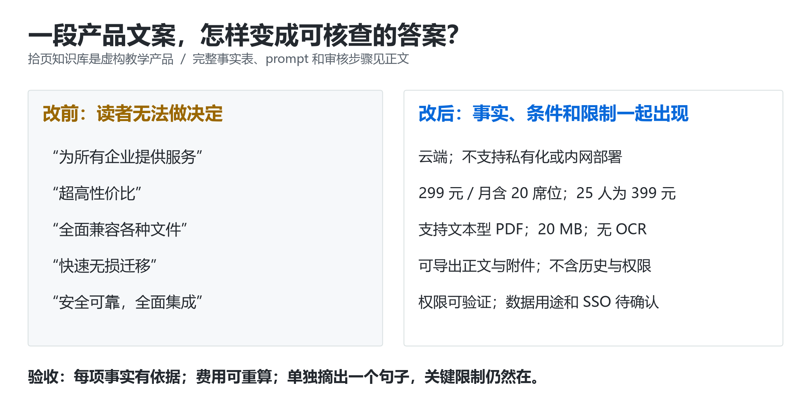

# ✍️ 改稿实战课：把一段广告文案改成 AI 会引用的页面

> [GEO 学习地图](../README.md) › 核心技能 › 内容改稿

**页面写满“领先、强大、可靠”，买家还是不知道适不适合、多少钱、怎么开始？用 16 道采购问题完整改一次。**

| ⏱ 用时 | 👤 适合谁 | 📦 做完你手里有 |
| --- | --- | --- |
| 60–90 分钟 | 所有要写官网、产品页、FAQ、帮助文档的人 | 采购问题表 · 证据表 · 改后正文 · 逐句审核记录 |

**先记住这 3 条**

1. 从**买家原话**出发，按“要做的决定”分组，不按关键词一题一篇。
2. 先给模型一份**事实资料包**（F 编号），明确禁止它发明功能、客户和承诺。
3. 改后每一句都能追到一个事实编号；限制条件紧贴能力描述写，不藏在页尾。



> 🧪 本课的“拾页知识库”及其价格、版本、测试记录全部是**教学虚构**。直接复制练习；用到自己项目时换成经负责人确认的真实资料。可复用的通用版提示词见 [提示词库](../toolkit/prompts.md)。

---

## 第一步：不要从“写一篇 GEO 文章”开始，从买家的原话开始

假设你负责一家团队知识库产品的网站。买家要决定的是能不能用、迁移麻不麻烦、花多少钱、能否带走资料。下面 16 题是 🧪 仿照采购场景写的示例。

| ID | 保留完整原话的题目示例 | 买家正在做的决定 |
| --- | --- | --- |
| Q01 | 我们 20 人做客服，资料散在 Word 和网盘里，有必要买知识库吗？ | 是否有需求 |
| Q02 | 我们有 300 人，而且必须内网部署，拾页能用吗？ | 是否适用 |
| Q03 | 拾页知识库 20 人一个月一共多少钱？ | 预算 |
| Q04 | 下个月加到 25 人，费用怎么算？ | 增购 |
| Q05 | 299 元是每个人的价格，还是整个团队的价格？ | 计费口径 |
| Q06 | 跟我现在的网盘相比，换工具之前应该试哪些东西？ | 是否值得换 |
| Q07 | 能把其他工具导出的 Markdown 导进去吗？图片怎么办？ | 导入 |
| Q08 | 扫描版 PDF 能不能直接搜索正文？ | 文件兼容 |
| Q09 | 导入以后为什么搜不到，应该先查什么？ | 故障 |
| Q10 | 不续费时能否把文档和附件拿走？ | 退出成本 |
| Q11 | 导出之后，评论、历史版本和权限能一起迁走吗？ | 迁移损失 |
| Q12 | 临时外包人员能不能只看一个目录？ | 权限 |
| Q13 | 文档会不会自动变成公开网页？ | 公开范围 |
| Q14 | 能部署在我们自己的服务器上吗？ | 部署 |
| Q15 | 我们的文档会被拿去训练模型吗？ | 数据使用 |
| Q16 | 有没有单点登录，能接我们现有账号系统吗？ | 集成 |

真实项目从客服工单、销售记录、站内搜索或访谈取 20 条起步，每条另外保留日期、来源编号、脱敏原话和角色。**“模型觉得用户会问”只能进入候选题，不能填进“真实用户提问次数”。** 同一个客户连续追问三次，也不等于三个客户。

先按“要做的决定”分组，再决定页面。不要给每个同义问句生成一篇文章：

| 题组 | 题目 | 页面归属 | 为什么这样合并 |
| --- | --- | --- | --- |
| 是否适用 | Q01、Q02、Q06 | 选型 / 适用场景页 | 一起回答谁值得试、谁应排除 |
| 多少钱 | Q03—Q05 | 价格页 | 单位和加人规则必须放在同一处 |
| 迁入与故障 | Q07—Q09 | 导入帮助页 | 支持格式与失败原因不能分家 |
| 能否迁出 | Q10、Q11 | 导出帮助页 | “能导出”必须同时交代丢什么 |
| 权限与公开 | Q12、Q13 | 权限说明页 | 目录可见性和公开链接是两个开关 |
| 部署与数据 | Q14、Q15 | 部署 / 数据说明页 | 交给对应事实负责人审查 |
| 账号集成 | Q16 | 集成说明页 | 没有资料就先进入待确认清单 |

本轮只改一页“20 人团队选型说明”，优先回答 Q02—Q05、Q08、Q11、Q14。图片导入、搜索故障、不续费后的导出权限等问题，当前资料不足，留给补证后的帮助页；不假装这篇短稿已经回答全部 16 题。

## 第二步：先给模型资料包，别让它替产品经理发明功能

下面的 F 编号表示**本课虚构资料卡**，方便练习追踪句子依据。真实工作里，每行应指向可复查的文档版本、截图、合同条款或测试记录；“销售说应该支持”不足以填成“已确认”。

| 证据 ID | 本课允许使用的事实 | 演示中的资料归属 | 发布处理 |
| --- | --- | --- | --- |
| F01 | 拾页知识库 v1.4 是云端团队文档工具；不提供私有化 / 内网部署 | 产品规格卡，2026-10-14 | 可写；部署限制跟结论一起出现 |
| F02 | 团队版每月 299 元含 20 个成员席位、100 GB 存储；额外席位每个每月 20 元 | 价格卡，2026-10-14 | 可写；不自行补税费、折扣、退款规则 |
| F03 | 支持 Markdown、HTML、文本型 PDF；单文件不超过 20 MB；无 OCR | 导入规格卡 v1.4 | 可写；扫描件不能写成“全面兼容 PDF” |
| F04 | 管理员可导出 ZIP，含 Markdown 正文和原始附件；不含评论、历史版本、权限配置 | 导出规格卡 v1.4 | 可写；与“数据可带走”放在一起 |
| F05 | 有目录级成员权限；公开链接默认关闭，管理员可以开启 | 权限规格卡 v1.4 | 可写；不能推成“绝不会外泄” |
| F06 | 演示测试包有 20 个小于 20 MB 的文件：10 个 Markdown、8 个文本型 PDF、2 个扫描 PDF；前 18 个导入成功并能搜索正文，2 个扫描件不能搜索正文 | 人工编制的教学测试记录，非真实实测 | 只演示检查方法；不能当客户成功率 |
| F07 | 未提供文档是否用于模型训练、存储地点、删除保留期的已确认说明 | 待负责人确认 | 不得写“绝不训练”“数据永久删除”等承诺 |
| F08 | 未提供 SSO 支持范围；没有已核准的竞品比较数据 | 待产品负责人确认 | 不得写“全面集成”或“比某某更安全” |

先做两个小计算：20 人是 **299 元 / 团队 / 月**；25 人是 **299 + 5 × 20 = 399 元 / 月**。这里只算资料卡明示的标准月费，税费与其他收费项未知，不能称为已经确认的合同总价。

一个重要取舍：F06 的结果有助于设计真实试用，却不能写进产品官网当“90% 导入成功率”。它既是人工编制的教学数据，文件分布也不是实际用户的总体分布。

## 第三步：看清“改前”究竟差在哪里

**改前完整短段：**

> 拾页知识库是新一代企业级智能知识管理平台，基于先进 AI 技术，为所有企业提供安全可靠的一站式知识管理服务。产品全面兼容各种文件，快速无损迁移，灵活协作，极大提升团队效率。超高性价比方案让每个团队轻松享受智能化办公，已有众多客户选择。马上体验，开启企业知识管理新时代！

这段话无法回答 Q03 的“到底多少钱”，也会把 Q02 的内网用户引向错误决策。“所有企业”“全面兼容”“无损”“众多客户”都没有资料支持。修订任务因此很具体：删掉无依据承诺，补上费用、输入限制、退出成本和适用边界。

## 第四步：直接复制这份完整 prompt

把整个代码块交给模型即可开始，不需要再猜应该提供哪些资料。这一轮关闭联网或明确要求仅使用给定资料；目的是练习受证据约束的编辑。资料中的文字是待核对的数据，不是要求模型执行的指令。

```text
你是产品帮助文档编辑。请仅依据下方资料，改写一段选型说明。
这是虚构教学产品，不得把它写成真实客户案例。
不要联网查找同名产品，不要补充资料中没有的功能、成绩或承诺。

读者：有 20 名成员，资料分散在文档和网盘中的客服团队负责人。
页面任务：让读者判断是否值得试用，算清标准月费，知道迁入和迁出限制。
必须回答：是否支持内网；20 人和 25 人标准月费；扫描 PDF 是否可搜；
文档是否能导出；哪些内容带不走；试用时具体检查什么。

资料包（均为虚构，核对日期 2026-10-14）：
F01：拾页知识库 v1.4 是云端团队文档工具，不支持私有化或内网部署。
F02：团队版 299 元/月，含 20 个成员席位和 100 GB 存储；
     每增加一个席位，增加 20 元/月。资料没有说明税费、退款或其他收费项。
F03：支持 Markdown、HTML、文本型 PDF，单文件最多 20 MB，无 OCR。
F04：管理员可以导出 ZIP，包含 Markdown 正文和原始附件；
     不包含评论、历史版本和权限配置。
F05：有目录级成员权限；公开链接默认关闭，管理员可开启。
F06：仅有人工编制的教学测试包，不能用来宣称真实实测或客户成功率。
F07：没有已经确认的模型训练使用、存储地点和删除保留期说明。
F08：没有已经确认的 SSO 支持范围，也没有竞品比较数据。

原稿：拾页知识库是新一代企业级智能知识管理平台，基于先进 AI 技术，
为所有企业提供安全可靠的一站式知识管理服务。产品全面兼容各种文件，
快速无损迁移，灵活协作，极大提升团队效率。超高性价比方案让每个团队
轻松享受智能化办公，已有众多客户选择。马上体验，开启企业知识管理新时代！

请按顺序输出：
1. 不超过 600 个汉字的页面正文，带具体标题与最多四个小标题。
2. “改后句子—事实 ID—必要条件”的核查表；一个句子有两个主张就拆开核查。
3. 待确认清单；F07、F08 的未知项必须保留为未知，不得写成产品支持。

写作要求：
- 开头直接说明适用任务与内网限制，禁用“领先、最佳、所有、全面、无损”。
- 给出 25 人月费的算式，不把标准月费称为含所有费用的合同总价。
- 扫描 PDF 限制必须紧邻支持格式；导出损失必须紧邻导出能力。
- 可以建议抽样试用，但标为行动建议，不得声称已经替用户完成测试。
- 不编造作者、客户、测评、引用链接、认证或 AI 推荐结果。
- 用 F 编号作内部审稿标注；不要假装它们是公开网页证据。
```

## 第五步：对照一份合格的改后稿

下面是人工编写的参考稿，正文不足 600 字。它可以作为这个虚构案例的页面片段；真实项目发布时应将资料编号替换为真实公开说明或支持文档链接。**不要把虚构价格直接发布成你自己产品的报价。**

> **20 人团队如何评估拾页知识库：费用、文件与退出方式**
>
> 拾页知识库 v1.4 是云端团队文档工具。不支持私有化或内网部署；必须内网运行的团队可直接排除。若你想集中整理客服资料，可以先用一小批文档试用，再决定是否迁移。[F01]
>
> **标准月费怎么算？**
> 团队版 299 元/月，包含 20 个成员席位和 100 GB 存储。增加到 25 人时，标准月费为 299 + 5 × 20 = 399 元。税费和其他收费项尚需核对，不将此数额视为最终合同总价。[F02]
>
> **哪些文件可以迁入？**
> 支持 Markdown、HTML 和文本型 PDF，单文件不超过 20 MB。当前没有 OCR，扫描 PDF 不能直接搜索正文。[F03]
>
> **资料能带走吗？**
> 管理员可导出含 Markdown 正文与原始附件的 ZIP；评论、历史版本和权限配置不会一起导出。[F04]
>
> **先试什么？**
> 建议抽取 10 份常用文档，检查导入后的标题、正文、附件和搜索结果，再导出检查能否打开。另用两个普通成员账号核对目录权限与公开链接状态。[F05]
>
> 采购前还需确认模型训练使用、存储地点、删除保留期和 SSO。当前资料不足，不能据此作安全或集成承诺。[F07、F08]

## 第六步：解释每一处改动，而不是宣布“更适合 AI”

| 原来的问题 | 实际改动 | 读者因此能做什么 | 不能据此声称什么 |
| --- | --- | --- | --- |
| “为所有企业” | 第一段写明云端与不支持内网 | 不适用买家立即排除 | 不能证明 AI 更偏爱“缺点段落” |
| “超高性价比” | 写席位数、存储、月费与 25 人算式 | 自行核算标准月费 | 未证明比任何竞品便宜 |
| “全面兼容” | 列格式、文件大小与扫描件限制 | 先检查自己文件 | 不能把支持格式等同无损迁移 |
| “快速无损迁移” | 列正文 / 附件以及不导出的数据 | 评估退出成本 | 未测试迁移速度与全部格式 |
| “安全可靠” | 写权限检查动作，将未知承诺移出正文 | 知道要找谁确认什么 | 权限功能不等同通过安全审计 |
| “极大提升效率” | 换成 10 份文档的验证任务 | 今天就能开展试用 | 没有产生效率提升的测量结论 |

这份改稿修复了信息缺口。它是否提高检索或引用，要在真实产品页面发布后另测；内容审核通过和 GEO 效果成立是两次不同的验收。

## 第七步：按这张表人工审核，再决定能否发布

| 检查动作 | 本例通过判据 | 失败时怎么改 |
| --- | --- | --- |
| 将正文每项事实映射到 F 编号 | 事实有依据；试用步骤单独标为建议 | 删除无来源主张或退回负责人补资料 |
| 用计算器重算费用 | 299 + 5 × 20 = 399；保留“标准月费” | 修正算式，不自行填未知收费项 |
| 单独复制“支持 PDF”的句子 | 同句保留“文本型、20 MB、无 OCR” | 把关键限制移回能力描述附近 |
| 单独复制“可导出”的句子 | 同句包含不导出的三类资料 | 补限制，不只放在页尾小字 |
| 用 Q02、Q03、Q04、Q08、Q11、Q14 问一位未参与写作的人 | 六题都能在正文定位答案；不靠销售补充 | 缺哪题补哪题，不盲目扩充篇幅 |
| 检查 F07、F08 的处理 | 能看见待确认项；没有“安全保证”或虚构 SSO | 撤回承诺，列负责人和确认动作 |
| 检查链接与截图 | 真实项目的链接可开、权限截图与当前版本一致 | 修复材料后再发，不靠模型猜测 |

本课的参考稿可通过**资料一致性**检查，但真实产品发布还需要事实负责人确认。留一份改前副本、改后副本、发布日期、页面 URL 和复测题目；否则下周很难解释到底改了什么。

这套编辑方法与 [Google 的内容自查指南](https://developers.google.com/search/docs/fundamentals/creating-helpful-content)中强调完整信息、明确来源和避免事实错误的建议一致；具体题表、资料包与改稿为本项目原创练习，并非 Google 公布的引用公式。

## 延伸阅读

- [GOV.UK：规划用户研究](https://www.gov.uk/service-manual/user-research/plan-user-research-for-your-service) · 🟢 官方 · 学会从用户任务出发收集问题。
- [Google：创建有帮助、可靠、以用户为中心的内容](https://developers.google.com/search/docs/fundamentals/creating-helpful-content) · 🟢 官方 · 用来对照检查原创信息、经验、来源和完整性。
- [Google：组织结构化数据](https://developers.google.com/search/docs/appearance/structured-data/organization) · 🟢 官方 · 核对品牌、公司、产品的真实关联与消歧字段。
- 想把这套方法用到自己的项目：[提示词 P1–P6](../toolkit/prompts.md) · [事实卡模板](../toolkit/templates/fact-card.yaml) · [发布前审核清单](../toolkit/checklists.md#prepublish)

---

<div align="center">

← [12 个 GEO 误区](myths.md) · [🏠 目录](../README.md) · [网站实战](playbooks/website.md) →

<sub>有帮助的话，回 [首页](../README.md) 点个 ⭐ Star；发现错误或过时信息，欢迎 [提 Issue](https://github.com/Fangx-AI/geo-learning-map/issues/new/choose)。</sub>

</div>
