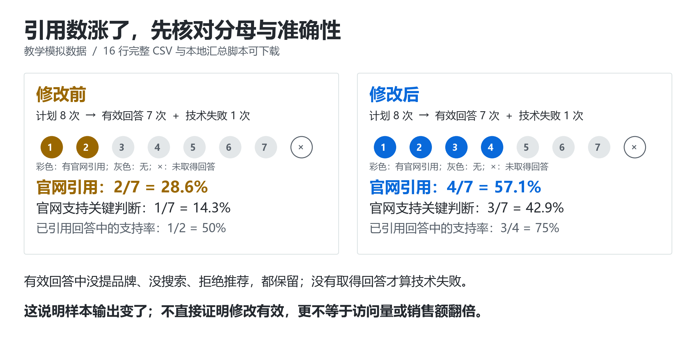

# 📏 测量：怎样知道 GEO 做完有没有用

> [GEO 实战手册](../README.md) › 测量与研究 › 效果测量

**偶尔被提到算有效吗？引用变多为什么没带来咨询？工具里的 visibility 到底怎么算？用 16 行数据跟算一次就懂。**

| ⏱ 用时 | 👤 适合谁 | 📦 做完你手里有 |
| --- | --- | --- |
| 30 分钟入门 · 进阶 2 小时 | 所有要给老板/客户汇报 GEO 效果的人 | 一套固定题集 · 运行记录表 · 五项指标的计算方法 · 一份不夸大的结论 |

**先记住这 3 条**

1. 五层分开记：**提及 → 引用 → 引用是否准确 → 可识别访问 → 业务成交**。哪层改善就报哪层。
2. 请求失败不算“没提及”；拒答、没推荐也是有效样本，不能删。
3. 引用从 2/7 到 4/7，是 **+28.6 个百分点**、相对 **+100%**。两种写法分清，别把百分点写成百分比。

**现在就能做**：[下载 16 行模拟数据](../examples/observation-demo.csv)，运行 [本地汇总脚本](../scripts/summarize_observations.py)（不联网、不调用模型）。

---

## 入门 · 跟算一次：引用从 2 次变成 4 次，究竟说明什么？

> 🧪 本节数据为教学模拟。先用 16 行数据练会记账，再换成自己的观察记录。**不用先买监测软件。**



**第一步：把题目、运行和来源分开。** 下面是四道冻结题；一个问题的两次运行仍然属于同一问题，不能算成两个独立需求。

| 编号 | 完整题目（虚构产品练习） | 意图 |
| --- | --- | --- |
| Q01 | 一个 12 人团队想集中管理项目文档，应该按哪些条件挑选知识库？ | 非品牌选型 |
| Q02 | 拾页知识库支持私有化部署吗？必须离线使用的团队适合吗？ | 品牌核验与排除条件 |
| Q03 | 从本地 Markdown 文档迁移到团队知识库，要检查哪些导入、附件和导出问题？ | 迁移约束 |
| Q04 | 知识库订阅按成员数计费时，应怎样计算团队的实际成本？ | 采购计算 |

上表仅用于理解题型与模拟 CSV，不用于在线测试虚构产品。实际项目先用真实名称、事实与用户任务重建题集，再扩充来自客服、销售、搜索或访谈的问题并保留来源。不要把“请推荐某品牌”这种带答案的问句混入非品牌发现题。

**第二步：为真实项目建立完整的计划表，再去提问。** 本课虚构题只解释模拟 CSV；没有自己的项目时用 [中文平台的 Notion 观察课](platforms/china.md#lab)。下载 [观察记录空表](../examples/observation-template.csv)，每个计划运行先占一行，例如同一道真实问题在周一、周三、周五各一次。时间表是控制观察的教学建议，不是平台刷新周期。基线期和复测期保持相同题集、入口、地区、语言、会话协议和重复次数；一次新增会话只测一题，避免上一题诱导下一题。

每次记录这五组信息：

1. **测试条件**：时间与时区、平台、网页/App/API、界面显示的模型版本、地区/语言、登录与记忆设置；看不到的版本填未知。
2. **联网情况**：开关是什么、是否实际显示搜索过程或来源。这两者分开。没有联网的正常回答也保留。
3. **完整证据**：题目原文、回答全文、截图、每条引用的实际 URL，以及引用对应的句子。截图用于保留界面，全文用于检索复核。
4. **人工标注**：提及品牌吗？引用了你的域名吗？引用是否真的支持紧邻的判断？只要粘了链接就给准确性满分会失真。
5. **失败**：超时、限流、登录失效等没有拿到回答的运行记为 `technical_error`。拒绝推荐、没提品牌、没搜索，只要返回了正常答案，都是 `ok`，不能删除。

**第三步：统一这份示例的计数规则。** 每行代表一次计划运行；重复出现十次同一域名，这一行仍只算一次“引用官网”。此处 `supported_citation=1` 采用严格规则：先把该回答中目标域名的所有引用逐条核完，全部支持各自附着的关键判断才记 1；有一个不支持就记 0。没有引用目标域名时留空。有引用但尚未全部核完时也留空，等补核完成再运行严格汇总脚本，不能凭已审核的部分给满分。

| 状态 | 提及品牌 | 引用官网 | 支持引用判断 | 如何计数 |
| --- | --- | --- | --- | --- |
| 正常回答，提及拾页但只引第三方 | 1 | 0 | 留空 | 进入有效分母，官网引用不加分 |
| 引官网，但把“仅云端”说成可离线 | 1 | 1 | 0 | 引用加分，准确支持不加分 |
| 回答说不适用，正确引官网限制 | 1 | 1 | 1 | 仍是准确引用，不需要夸奖产品 |
| 回答正常但没提品牌、没有搜索 | 0 | 0 | 留空 | 进入有效分母 |
| 页面超时，未取得回答 | 留空 | 留空 | 留空 | 留在计划表，进入失败率 |

**第四步：运行已经填好的文件。** [16 行模拟记录](../examples/observation-demo.csv)可用表格软件打开。仓库中的 [汇总脚本](../scripts/summarize_observations.py)仅用 Python 标准库、本地读 CSV，不联网、不调用模型。进入仓库目录执行：

```bash
python scripts/summarize_observations.py examples/observation-demo.csv
```

本脚本用于通用观察表，每份文件只保留同一平台、入口、地区与会话/搜索协议的前后观察。脚本会检查这些可选条件列，发现混组或缺失会拒绝汇总；多个平台分别导出 CSV，不能直接合算。先完成全部计划运行与人工标注；未完成项另报原因，不伪装成技术失败。中文观察课的两张 CSV 采用不同字段，需整理成通用观察表并补齐标注后统计，不能直接把 `not_run` 计划表交给本脚本。

结果应包含下面这些值（脚本还输出每题的引用分布）：

```text
[before] questions=4 planned=8 valid=7 errors=1
mention_rate=4/7 (57.1%)
citation_rate=2/7 (28.6%)
supported_answer_rate=1/7 (14.3%)
support_within_cited=1/2 (50.0%)
failure_rate=1/8 (12.5%)

[after] questions=4 planned=8 valid=7 errors=1
mention_rate=5/7 (71.4%)
citation_rate=4/7 (57.1%)
supported_answer_rate=3/7 (42.9%)
support_within_cited=3/4 (75.0%)
failure_rate=1/8 (12.5%)
```

**第五步：写出正确的结论。** 官网引用回答占有效回答的比例从 `2/7` 到 `4/7`，提高约 **28.6 个百分点**，相对增幅 **100%**。但它没有告诉你搜索量、真实曝光、访问量或成交量；只有四个问题，也不能写“全网 AI 可见度翻倍”。准确支持率还需独立报告，不能让错误引用混在“成功”里。

技术失败的真实输出未知。基线的引用比例按全部计划运行计算，可能介于 `2/8` 和 `3/8`；复测介于 `4/8` 和 `5/8`。这是缺失值的上下界，不是统计置信区间。扩大真实实验时按问题家族和时间检查波动，不把所有调用当独立样本。

**第六步：把引用和生意接起来。** 分开保留“固定题集记录”“可识别的引荐访问”“业务事件”三张表，只有可追踪的同一访问链才关联。下表是实施规格示例，不是平台自带的统一事件名称：

| 项目 | 自己定义的事件 | 什么才算完成 | 常见误计 |
| --- | --- | --- | --- |
| 内容网站 | `newsletter_confirmed` | 用户完成确认订阅 | 点了订阅按钮 |
| 小程序 | `booking_confirmed` | 预约记录创建成功且非测试单 | 展示了小程序二维码 |
| SaaS | `first_workspace_created` | 首个工作区创建成功 | 只访问登录页 |
| 桌面软件 | `first_successful_export` | 首次成功导出任务 | 下载了安装包 |
| B2B 服务 | `qualified_lead` | 按预先标准审核为有效需求 | 收到任何表单/垃圾线索 |

不能把所有 direct 流量算为 AI，也不能把网站到小程序跳转失败的人当成已成交。已有分析系统可以按自身事件定义实现；GA4 的关键事件与广告转化有不同产品定义，先读[官方说明](https://support.google.com/analytics/answer/13965727?hl=en)。

**本课验收**：能重算五个比率；保留那两次技术失败；找到被标为 `supported_citation=0` 的两行，并指出缺少原回答、引用句与来源正文，因此本模拟文件只能练计算，不能独立核实那些标签。解释为什么结果上涨仍不证明改稿导致增长。真实项目再补原始证据、未改页面组、同期营销活动、发布与抓取时间，才能进一步讨论原因。

---

## 进阶 · 设计一套经得起老板追问的测量方案

> 下面的指标口径和练习协议是本项目的建议；平台官方指标另行标明。行业里**不存在**统一的“GEO 分数”，任何工具的 visibility 都要先问清定义。

学习如何判断一项改动是否在指定条件下改善可见度，同时确认回答质量与业务结果有没有变差。最终应能交付固定题集、完整运行记录、分母清楚的报告和可复查的实验结论。

先理解检索、生成和引用的区别；会使用表格即可开始。统计推断、API 与脚本属于进阶部分。

## 先读这三份官方/学术资料

### 1. Google Search Console：Generative AI performance report (Search)

[官方报告说明](https://support.google.com/webmasters/answer/16984139)

`🟢 官方` `入门` `英文` · 平台官方指标文档

**📌 要点：** 理解生成式 AI 展示量及页面、国家、设备、日期维度，注意站点汇总与页面汇总的差异。文档说明报告覆盖 AI Overviews、AI Mode，并排除 Search Labs 实验。

**⚠️ 不能推出：** 截至核验日，这份文档列出的核心指标是展示量，不能自行补成独立点击率、推荐率或转化。未见报告可能与展示量不足有关；不要把缺报表等同于零曝光。

### 2. ALCE：引用评估代码与人工评估材料

[princeton-nlp/ALCE](https://github.com/princeton-nlp/ALCE)

`📄 资料` `进阶` `英文` · 作者评估实现与人工标注材料

**📌 要点：** 查看 `eval.py` 和 `human_eval/`，理解为什么引用质量需要和正确性分开。即使不运行，也可借鉴“答案—具体断言—引用证据”的记录方式。

**⚠️ 不能推出：** 自动评估仍需人工抽查。论文数据集与当时依赖不能代表任意中文商业问答；本页简化指标不是逐项复刻 ALCE 官方指标。

### 3. Microsoft Clarity：Citations Dashboard

[官方指标说明](https://learn.microsoft.com/en-us/clarity/ai-visibility/citations-dashboard)

`🟢 官方` `入门` `英文` · 平台官方指标文档

**📌 要点：** 对照 page citations、Share of authority、AI referral traffic，练习辨认引用次数、引用份额和网站会话占比。尤其注意 Share of authority 的统计范围。

**⚠️ 不能推出：** 文档的 Share of authority 在查询的日级统计中排除本域未获引用的日子，不能与覆盖全部固定题集的引用份额直接比较。Grounding queries 是系统检索查询，可能不是用户原始提问。

## 第一步：固定问题集合

先写业务问题，再选题。例如：“在中文、某地区、某产品入口的非品牌服务推荐题中，我的服务被合理推荐的比例是否变化？”不要先看哪些题表现最好，再倒推测试目标。

建议为每个查询建立一行：

| 字段 | 记录内容 |
| --- | --- |
| `query_id`、`family_id` | 稳定编号；相同意图的改写归入同一查询家族 |
| `query_text`、`query_version` | 完整原句和题集版本；评估中不静默改题 |
| 语言、目标地域 | 分别记录；中文问题不自动代表中国大陆使用场景 |
| 意图 | 事实查询、入门学习、比较、推荐、交易前核验、排错等 |
| 品牌属性 | 非品牌、自己的品牌、竞品；分别汇报 |
| 业务约束 | 预算、用途、受众、地区、规格和排除条件 |
| 正确答案依据 | 可核验事实、合适答案范围和不应出现的错误断言 |
| 权重与来源 | 权重是否相同；题来自真实公开需求、站内反馈或人工构造 |

保留一份开发题集用于调试，一份冻结的评估题集用于最终验证。题集必须有失败机会，包括你不适合被推荐、证据不足、事实需要更新的问题。人工构造题集只代表这些题，不能冒充平台全体用户需求的随机样本。

## 第二步：把一次运行记录完整

同一个品牌在不同入口可能经历不同检索与生成流程。**API、网页产品、移动端、搜索模式、深度研究模式分别作为测试对象**；同名模型也不能默认结果可互换。

| 类别 | 最小记录字段 |
| --- | --- |
| 运行身份 | `run_id`、`query_id`、`family_id`、UTC 时间、展示时区、实验组、重复编号 |
| 产品入口 | 平台、网页/App/API、模式、产品可见版本、模型标识；不可见则写 `unknown` |
| 用户环境 | 登录状态、账号档位、地域、界面语言、提问语言、设备；不保存密码或个人敏感内容 |
| 上下文 | 是否新会话、历史消息、记忆或个性化状态；无法关闭则记录 |
| 检索状态 | 请求是否允许联网、是否实际观察到搜索、公开可见的搜索查询与来源；看不到内部过程时写 `unknown` |
| API 参数 | 可用时记录模型版本、temperature、seed、工具、系统提示；不支持的参数写 `not_available` |
| 输出与证据 | 完整回答、截图或原始响应、引用 URL、证据片段、标注版本与标注人 |
| 运行失败 | 超时、限流、连接错误、区域不可用、截断、解析错误及原始错误信息 |
| 内容状态 | 被测试页面的版本与发布时间；是否有抓取/索引/检索证据及时间 |

“模型回答了但没有推荐”“拒答”“完成回答但未触发搜索”都是需要保留的产品行为。网络失败、抓取中断、解析丢失则单列技术失败。不要只保存最满意的一次回答，也不要重试到出现目标品牌才算完成。

## 第三步：先规定指标分母

以下定义用于本项目的固定题集实验。`N_plan` 是预先计划运行次数，`N_valid` 是取得可判读完整产品输出的次数；拒答、无引用、无推荐仍属于有效产品输出。技术失败不偷偷记为“未提及”，要报告失败数及其分布。分母为零时填 `NA`，不是 0%。

| 指标 | 分子 / 分母 | 判定与限制 |
| --- | --- | --- |
| 运行完成率 | `N_valid / N_plan` | 单列技术失败类型；若两组完成率差异大，不只比较剩余答案 |
| 正文提及率 | 正文明确提及目标实体的有效回答数 / `N_valid` | 统一别名、排除同名误识别；负面提及也计提及，但情感另记；引用列表出现域名单独计 |
| 推荐率 | 明确把目标列为适合该需求选项的回答数 / 预先标记为推荐意图题的有效回答数 | 明确否定、只作比较、不适用说明不算推荐；有条件推荐需满足预先标注规则 |
| 域名引用率 | 至少引用一次目标域名的回答数 / `N_valid` | 一次回答最多计一次；与品牌被提及不同；保留原始及规范化 URL |
| 引用份额 | 目标域名的去重引用实例数 / 全部域名的去重引用实例数 | 本协议一个实例为“回答×规范化 URL”；同回答同 URL 重复只计一次；涵盖整个题集，不能与其他工具不同口径硬比 |
| 关键事实正确率 | 经证据核对为正确的可核验断言数 / 全部被标注的可核验断言数 | 标签分正确、错误、证据不足；证据不足仍留在分母，另报占比；同时报告断言覆盖量与答题率，防止靠少答提高得分 |
| 引用支持精度 | 来源确实支持对应断言的“断言—引用”配对数 / 全部被检查配对数 | 打开来源检查，链接存在不算支持；若链接无法访问，标为未知并另报，未验证项不计成功 |
| 引用覆盖率 | 至少被一条或一组引用充分支持的需证据断言数 / 全部需证据断言数 | 没链接的断言仍在分母；与“有多少条引用”不同 |
| AI 来源会话占比 | 按固定来源规则识别的 AI 引荐会话数 / 同期全站可观测会话数 | 保存识别规则与未知来源；这不是答案点击率 |
| AI 来源会话转化率 | 至少发生一次指定业务事件的 AI 引荐会话数 / AI 引荐会话数 | 预先指定事件，例如有效咨询或支付；事件次数不能混作去重会话数 |

“来源支持”与“事实正确”分别标注：来源可能本身有错，答案也可能碰巧正确却没有引用支持。正文中“暂不建议选择某品牌”可以计提及，但不计正向推荐。

对推荐率再给一个**合理推荐率**：满足预先定义的需求约束、事实没有关键错误的推荐回答数，除以同一推荐题有效回答分母。这样可以避免奖励不合适的推荐。领域判断存在争议时保留理由，不把主观意见包装成事实标签。

对于缺失的技术失败，可给提及或引用的敏感性区间：最低可观测比例为成功次数除以 `N_plan`；最高可能比例为“成功次数＋技术失败次数”除以 `N_plan`。这不是统计置信区间，只说明未知结果可能造成多大影响。

**别把不同数据源的分母接在一起**

- 固定题集的回答数、平台真实展示量、分析系统的会话数是三个不同分母。
- 没有同一范围内的真实曝光和点击，就不能计算可靠的“答案 CTR”。不要用自己测的 100 次答案作真实用户点击的分母。
- 付费工具的 visibility、share of voice、authority 可能有不同题集、权重、去重、过滤或采样方式；先索取定义，再比较趋势。
- 识别不到来源的访问保留为未知。不能把所有 direct 流量都算给 AI，也不能把可识别的 AI 引荐当作全部 AI 影响。

## 第四步：处理随机性与时间变化

以下是入门实验建议，不是保证统计显著的万能样本量。

1. **预先规定重复计划。** 小练习可用 12—24 道题，每题每条件至少 3 次，分布在多个时间窗口。预算不足时减少题量并注明探索性，不挑选最佳运行。
2. **分开两个问题。** 同一时间窗内重复观察回答随机性；跨日、跨周重复观察系统和网页变化。把二者混成一个平均数会掩盖原因。
3. **能控制时进行配对和随机化。** 离线实验在同一题、同一候选来源下比较 A/B，并随机顺序；需要研究上下文位置时单独设实验。线上网页改动通常无法同时随机展示两个已索引版本，不应伪称标准 A/B 测试。
4. **先按题或查询家族汇总。** 相同问题的 30 次调用不是 30 个独立用户问题。报告每题的重复分布、各意图平均和失败率，再按预先权重汇总。
5. **报告不确定性。** 报原始计数、百分点变化和区间。进阶可按查询家族做配对聚类 bootstrap；若跨日相关明显，还需考虑时间块。少量查询的区间不代表全市场不确定性。
6. **不要边测边挑停点。** 提前规定总样本、观察窗口、主指标和结束条件。大量测试中只挑一个增长结果，容易产生偶然发现；探索结论留到新题集和新时间窗验证。

温度设为零或固定 seed 也不能保证整个搜索产品不变：检索结果、模型服务、上下文和平台路由都可能变化。无法获得这些内部变量时，诚实标注为不可观测。

## 第五步：设计能解释结果的实验

| 设计 | 能回答什么 | 主要限制 |
| --- | --- | --- |
| 固定来源、固定模型，单变量改写 | 文本改变是否影响这一生成设置的使用或引用 | 未测真实检索、索引和用户行为 |
| 本地检索—重排—生成全流程 | 改写是否在自己的完整流程中产生阶段间取舍 | 不是商业搜索私有算法 |
| 商业产品固定题集持续观察 | 特定入口与时间窗内输出是否变化 | 变化可能来自模型、索引、竞品、地域或个性化 |
| 改页面前后比较，并保留未改页面组 | 改动是否伴随相对变化，可减少部分时间混淆 | 需检查组间可比性、更新差异和共同趋势；仍不自动证明因果 |
| 随机分配的用户或页面实验 | 在随机化单位与实验条件成立时估计干预效应 | 平台与内容间可能相互影响，污染对照；搜索抓取通常不可控 |

先写假设：“为页面补充真实、相关且可核验的证据，是否改善指定题集的引用支持率？”避免一次同时改标题、事实、站点结构、外链和品牌宣传，再声称是某一个动作有效。

页面发布不是平台已读取。记录抓取和索引证据、合理等待窗口、同期发布与营销活动；仍未知时明确写“无法确认干预内容已进入被测产品”。没看到效果既可能是方法无效，也可能是干预尚未进入流程。

比较均值时也查看负面结果：更多引用是否伴随错误增加；推荐更多是否违背适用条件；访问更多是否缺少合格咨询。先报告变化，再讨论可能解释。

## 扩展资源

### 4. Ragas: Automated Evaluation of Retrieval Augmented Generation

[原始论文](https://arxiv.org/abs/2309.15217) · [官方 Faithfulness 指标文档](https://docs.ragas.io/en/stable/concepts/metrics/available_metrics/faithfulness/)

`📊 研究` `进阶` `英文` · 原始方法论文与作者工具文档

**📌 要点：** 分离检索上下文、回答相关性和忠实性。Faithfulness 文档把回答中得到上下文支持的断言数除以总断言数，可帮助设计逐断言复核流程。

**⚠️ 不能推出：** 对上下文忠实不意味着事实在现实中正确；reference-free 也不意味着不需要人工核查。固定工具版本、评审模型与提示，并用自己语言和行业的人工样本校准。

### 5. ARES: An Automated Evaluation Framework for Retrieval-Augmented Generation Systems

[论文全文](https://arxiv.org/html/2311.09476v2)

`📊 研究` `研究` `英文` · 原始自动评估研究论文

**📌 要点：** 阅读上下文相关性、回答忠实性、回答相关性的分别判断，以及用人工标注配合 prediction-powered inference 估计得分与区间的思路。

**⚠️ 不能推出：** 不应拿一个未校准的 LLM 裁判输出当作客观真值。ARES 的统计程序有特定条件；只让模型打分再取平均不等于已经实现其方法。

### 6. Google：生成式 AI 报告发布与更新记录

[2026 年 6 月官方公告](https://developers.google.com/search/blog/2026/06/gen-ai-performance-reports)

`🟢 官方` `入门` `英文` · 平台官方发布记录

**📌 要点：** 学会对官方资料也核对时间。公告已更新说明相关报告于 2026-08-31 全球推出，包含生成式 AI 展示的单独视图；这部分数据也计入总体表现。

**⚠️ 不能推出：** 不再沿用“AI 表现只能混在 Web、完全无法拆分”的旧说法。单独视图不表示所有可能的业务指标都可拆分；以当前报告文档和实际账号可见字段为准。

### 7. Google Analytics：Conversions vs. key events

[官方定义](https://support.google.com/analytics/answer/13965727?hl=en)

`🟢 官方` `入门` `英文` · 平台官方分析文档

**📌 要点：** 明确业务关键事件、广告转化、计数方式与归因窗口，避免只用页面访问作为最终成功标准。为有效咨询、试用或支付建立稳定事件定义。

**⚠️ 不能推出：** 本页“会话转化率”是明确口径的业务指标；平台 key event 与 Ads conversion 应按其产品定义使用。来源归因分配的是观察到的触点信用，不等于该来源造成了新增购买。

### 8. AI in Search Reduces Publisher Referrals Without Improving User Experience: Experimental Evidence

[2026 年原始预印本全文](https://arxiv.org/html/2608.18352v1)

`📊 研究` `研究` `英文` · 预注册随机现场实验预印本

**📌 要点：** 查看 Google Search 的用户随机分组、真实行为测量、预注册与局限。该研究把外部访问与用户体验作为结果，有助于理解为什么品牌可见度、引用和引流不能互相替代。

**⚠️ 不能推出：** 干预的是实验条件下 AI 搜索功能的可用性，不是某个站点的 GEO 改写；结论不能推出“所有 GEO 策略都无用”或代表所有国家、设备和平台。

---

<div align="center">

← [中文平台](platforms/china.md) · [🏠 目录](../README.md) · [案例精读](cases.md) →

<sub>有帮助的话，回 [首页](../README.md) 点个 ⭐ Star；发现错误或过时信息，欢迎 [提 Issue](https://github.com/Fangx-AI/geo-doctor/issues/new/choose)。</sub>

</div>
