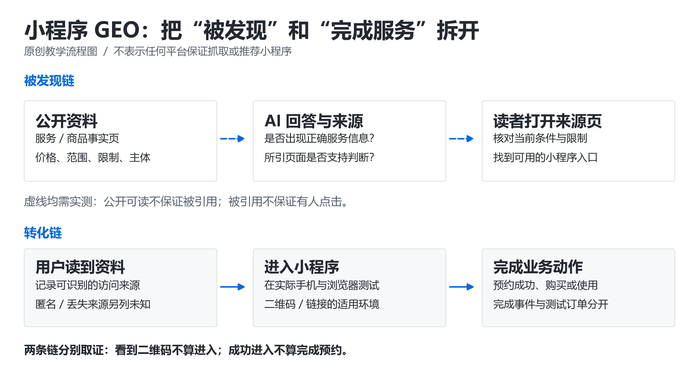

# 💬 微信小程序 GEO 实战

> [GEO 学习地图](../../README.md) › 按项目实战 › 小程序

**服务都在小程序里，AI 不知道你卖什么，用户也找不到入口？先把“被读到”和“进得来”分开打通。**

| ⏱ 用时 | 👤 适合谁 | 📦 做完你手里有 |
| --- | --- | --- |
| 7 天 | 预约 / 零售 / 工具 / 教育类微信小程序 | 一份公开服务说明 · 内容→小程序路径映射表 · 四种环境入口实测记录 |

**先记住这 3 条**

1. 外部 AI 一般读不到小程序内部页面。你需要一份**公开可读**的服务说明（官网单页或有正文的公众号文章都行）。
2. 公开页上每个事实都对应到一个具体小程序路径（门店页、预约页），不要全部落到小程序首页。
3. 入口必须在 4 种环境实测：微信内、微信外、桌面浏览器、已装未登录。“曝光问题”和“转化问题”分开排查。

---

## 第一步：先确认你要让哪一种系统发现什么

| 层 | 要检查的对象 | 能推出什么 / 不能推出什么 |
| --- | --- | --- |
| 微信内发现 | 实际微信搜索结果、小程序当前后台配置 | 微信里搜到，不等于 ChatGPT 或其他 AI 能直接读取小程序页 |
| 公开信息 | 官网、公开帮助、商品 / 服务说明、公众号文章 | 能在浏览器读到，不等于已经进入任何指定 AI 的检索集合 |
| AI 回答 | 目标 AI 本次实际引用的来源 URL | AI 引用了公众号文章，只能证明这一轮使用了这篇文章 |
| 小程序使用 | 入口、目标路径、登录、预约 / 购买 / 激活 | 成功打开小程序，不代表完成了业务目标 |

**本轮能核实的官方材料：** 微信官方 [miniprogram-demo 的 sitemap 示例](https://github.com/wechat-miniprogram/miniprogram-demo/blob/master/sitemap.json)包含 `rules`、`action` 和 `page` 配置；官方 [API 类型定义](https://github.com/wechat-miniprogram/api-typings/blob/master/types/wx/lib.wx.app.d.ts)列出了打开路径、query、场景值，以及 URL Link 入口。这些材料不证明公众 AI 可以读取全部小程序内容，也不证明元宝直接收录了你的小程序。

**实施前需在自己的后台复核：** [sitemap 文档](https://developers.weixin.qq.com/miniprogram/dev/framework/sitemap.html)、[URL Link 文档](https://developers.weixin.qq.com/miniprogram/dev/framework/open-ability/url-link.html)本轮工具未能取得正文；账号资格、跳转条件、配额及最新限制以实际后台和官方页面为准。下文不假定所有账号都能使用同一种外部跳转方式。

## 第二步：没有官网、已有官网、只有公众号，分别怎么做

| 现状 | 最小可执行方案 | 验证方法 |
| --- | --- | --- |
| 有官网 | 增加一页公开产品 / 服务详情；在该页完成事实解释，再引导到小程序 | 用[网站实战](website.md)检查响应和正文；实际点击小程序入口 |
| 只有小程序 | 建一页自己能持续维护的公开说明；内容不多可用单页，先不建设整套内容站 | 未登录的外部浏览器能读懂产品、条件、费用口径和使用步骤 |
| 只有公众号 | 发布有文字正文的使用说明，并逐篇测试分享链接在微信外的可访问性 | 无痕窗口、手机非微信浏览器各打开一次；记录正文 / 验证码 / 登录 / 错误 |
| 商品或服务都需要登录 | 公开通用说明和适用条件；账户记录与实时私人数据仍留在登录后 | 陌生人能判断是否适合，但读不到任何客户个人资料 |

公众号文章若在某个环境出现验证或打不开，记录该条件，不把它称为“全网可抓取”。若目标 AI 实际引用了文章，打开引用链接核对完整内容。只有官方产品说明提到“公众号资源”，仍不足以确认某篇文章已被纳入。

## 第三步：用一个具体例子把公开页面和小程序页面接上

> 🧪 **贯穿示例**：虚构的“海湾自习室”预约小程序。用户的问题是“附近有没有周末可用、允许带电脑的安静自习室”。

| 用户实际要问 | 公开页需要回答的事实 | 小程序承接位置 | 谁维护 |
| --- | --- | --- | --- |
| 在哪里，周末开不开 | 门店名称、地址、交通文字、周末营业时段、拍摄日期明确的门店图 | `pages/store/detail?id=harbor-01` | 门店运营 |
| 可以带电脑吗 | 允许的座位区、插座、通话规则；不要只放一个“设施齐全”图标 | 同店的座位类型说明 | 店长 |
| 多少钱，能退吗 | 按小时 / 天计费方式、优惠适用范围、取消条件；实时空位在小程序确认 | `pages/booking/create?store=harbor-01` | 价格 / 订单负责人 |
| 如何预约 | 选门店 → 选日期座位 → 确认规则 → 支付；每步真实截图 | 对应门店或预约页，避免全部落到小程序首页 | 产品负责人 |

**改前：** “环境优美、设施齐全、学习首选。扫码了解更多。”

**改后：**

> 海湾自习室的电脑区允许使用笔记本，座位配有电源。静音区不适合线上会议，通话需离开座位区。预约时先选择“电脑区”，再查看具体日期的空位和价格。周末营业时间、门店地址和取消规则见本页；点击“查看该店空位”进入对应门店，不需要重新搜索名称。

配三张真正有教学作用的图片：**门店实际入口、电脑区座位、小程序预约路径截图**。图注解释拍摄 / 截图时间及对应步骤；正文同时写出关键信息。二维码旁保留小程序准确名称与必要的文字步骤，手机用户可能无法方便地扫描当前屏幕。

## 第四步：测试入口，不把“生成一个链接”当作完成

1. 由后台或开发者使用账号当前获准的方式生成目标入口。URL Link、二维码、微信内卡片是不同入口，分别测试；没有权限的入口不要强行照抄别人的方案。
2. 为公开页到小程序的跳转设置自己的来源标记，例如 `source=public_guide`、`campaign=studyroom_202610`；只用不含个人信息的业务标记，先确认该入口允许携带参数。
3. 小程序接收路径与 query 后，验证门店 ID 存在、页已发布、参数没有丢失。不要因为参数异常直接落回首页而不记录错误。
4. 至少测四种条件：手机微信内、手机微信外、桌面浏览器、已安装但未登录。记录设备与微信版本；不支持的条件提供可理解的替代路径。
5. 从“查看空位”一直测到确认页；测试账户用于测试，避免为了验证而产生真实扣款。门店、日期和价格必须贯穿一致。

官方类型定义支持记录进入时的 `path`、`query`、`scene`；这些字段本身没有告诉你“这是某个 AI 带来的访问”。`scene` 是微信入口场景，不能直接改名为 AI 来源。[微信官方打开参数定义](https://github.com/wechat-miniprogram/api-typings/blob/master/types/wx/lib.wx.app.d.ts)

## 第五步：一周内完成一个公开内容到预约的闭环

| 天 | 做什么 | 交付物 |
| --- | --- | --- |
| 1 | 导出或人工整理 10 条脱敏客服原话，选一个门店与一个预约任务 | 问题表：问法、缺失事实、谁能确认 |
| 2 | 核对地址、营业时间、座位规则和取消规则；拍实际照片 | 有负责人和更新时间的事实卡 |
| 3 | 发布一份可读的公开说明，或改好现有说明 | 一个公开 URL；正文可读性测试记录 |
| 4 | 生成获准的小程序入口，写好目标路径与来源映射 | 一张 URL / 二维码 → 页面路径 → 业务事件表 |
| 5 | 用四种条件完成入口测试，修掉失效和落错门店的问题 | 屏幕截图、测试时间、是否到达正确页面 |
| 6 | 在目标 AI 联网入口跑固定问题，保存真实引用 | 回答与来源存档；没引用也记录 |
| 7 | 检查公开页阅读、入口点击、小程序到达和完成预约 | 漏斗报告；下一周只优先修最大掉点 |

## 验收与排错：曝光问题和转化问题分别处理

| 症状 | 怎么定位 | 下一步 |
| --- | --- | --- |
| AI 完全不知道小程序 | 查有没有可公开读取的产品事实，搜索结果与 AI 引用究竟是什么 | 补真实公开说明与相关资料；不承诺提交一次即可收录 |
| AI 能回答但没给入口 | 看被引用页是否有明确名称、适用入口和操作步骤 | 给该页补“怎样使用”，别只重复品牌词 |
| 外部文章可读，点击却打不开 | 对比账号权限、入口有效性、设备与环境 | 按当前官方条件调整入口，保留替代说明 |
| 打开成功但进入首页 | 检查目标路径、query、发布版本和参数处理 | 恢复到对应门店 / 商品；记录回退原因 |
| 小程序到达很多，预约很少 | 看价格差异、满位、手机号授权时机、支付与取消规则 | 修转化流程；不能直接推断 GEO 无效 |

分别报告：**AI 回答中的正确提及 / 引用、公开页访问、跳转按钮点击、小程序到达、去重完成订单**。保留下游业务口径与时间窗口。AI 可能不给 referrer，二维码也可能被转发；来源参数只能识别这条入口，不能证明每次访问来自 AI。无法确定的来源写“未知”，可另用自愿回答的“从哪里了解到我们”辅助判断。

---

← [网站实战](website.md) · [🏠 目录](../../README.md) · [独立产品实战](product.md) →

有帮助的话，回 [首页](../../README.md) 点个 ⭐ Star；发现错误或过时信息，欢迎 [提 Issue](https://github.com/Fangx-AI/geo-learning-map/issues/new/choose)。

